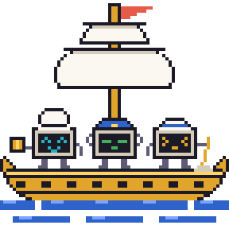

<!--
Scope: People deciding whether to try Ship: what it is and why, an honest split between what works and what isn't built, installation, and links into the guide.
Not here: keys, configuration and CLI walkthroughs (docs/site/).
-->

<div align="center">


**Ship - A Terminal Workspace for Working Alongside Coding Agents**

[Overview](#overview) •
[What works today](#what-works-today) •
[Installation](#installation) •
[Docs](#docs) •
[License](#license)

</div>

> [!WARNING]
> **Ship is a work in progress.** There are no releases yet. See [what works today](#what-works-today) and [what isn't built yet](#not-built-yet).

## Overview

Ship is a terminal multiplexer, like tmux or Zellij, except it treats coding agents as first-class citizens instead of just another program in a pane. Your shells and agents run in tabs and split panes on a background server, so they keep going after you close the window.

Programs can tell Ship what they're doing through a recently proposed protocol, the [Program Status Protocol](https://www.superlogical.com/rex/docs/build/program-status), and Ship shows it in the sidebar:

```text
─ agents ─────────────
▲ claude blocked
ship › api
● codex working
ship › docs
◆ pi unseen
site
```

So you can see what's working, what's waiting on you and what finished without flipping through tabs. Nothing about the protocol is specific to agents, but agents are where it's actually useful, and Claude Code, Codex, Pi and crush already support it. Support is up to each agent's authors, so there's no list of agents in Ship to keep up to date.

Everything Ship does is also a `ship` command that prints JSON, and it's the same binary your agent calls from bash. So an agent running in Ship can start another one and hand it work:

```sh
$ ship pane create --name worker -- claude
{"id":"pane:8df435b8…","name":"worker","command":["claude"],"status":{"state":"running"},…}

$ ship pane send --pane pane:8df435b8… "write a haiku about ships" --key enter --wait
{"id":"pane:8df435b8…",…,"program":{"":{"state":"done","app":"claude"}}}

$ ship pane read --pane pane:8df435b8…
write a haiku about ships
wooden hull at dusk
three small crewmates keep the watch
the build turns green
```

No SDK or plugin needed, same reason you'd just run grep instead of rewriting it in every language. [Handing work to another agent](docs/site/scripting/handing-work-to-another-agent.md) has the full loop.

The name started as a joke about shipping software faster, and the ship and crew theme grew out of that.

### Why another multiplexer?

[Herdr](https://github.com/herdrdev/herdr) already does a lot of this, and Ship is heavily inspired by it, but it tries to cover most of what Herdr does day to day with a much smaller codebase, by using libraries for the hard parts (terminal emulation from [Ghostty](https://ghostty.org), PTYs, transport) and only writing the tab, pane and agent parts itself.

## What works today

- **Detaching.** Close the window or press `alt-q` and everything keeps running until you come back. [More](docs/site/windows-and-the-server.md)
- **Saved tabs.** After a restart, your tabs, splits and directories come back with fresh shells. [More](docs/site/saved-tabs.md)
- **Agent status.** Agents that speak the Program Status Protocol show in the sidebar, with a sound when one needs you. [More](docs/site/agents.md)
- **Nested tabs.** A tab can hold its own tabs, and the sidebar shows them as a tree you can fold. [More](docs/site/tabs.md)
- **Split panes.** Split, zoom, swap and resize from the keyboard or the mouse. [More](docs/site/panes.md)
- **Several windows.** Attach from more than one terminal, each looking at its own tab. [More](docs/site/windows-and-the-server.md)
- **Scrollback and copy.** Scroll back through a pane's history and drag to copy. [More](docs/site/scrolling-copying-and-the-mouse.md)
- **A CLI that prints JSON.** Scripts and agents can do anything you can do from the keyboard. [More](docs/site/scripting/README.md)
- **Custom keys and menus.** Rebind anything, build tmux-style prefix modes, and change the right-click menus. [More](docs/site/configuration.md)

Linux and macOS are the priority platforms. Windows is best effort.

### Not built yet

- Releases and packages.
- Searching a pane's history, and a keyboard copy mode. For now, `ship pane read --lines N | grep ...` covers search.
- Resuming agent conversations or rerunning programs after a restart. Saved tabs come back with fresh shells.
- Closing a pane automatically when its program exits.
- Connecting to another machine's server directly. The server only accepts local connections for now, so [use an SSH tunnel](docs/site/windows-and-the-server.md#using-ship-on-another-machine).
- Testing on Linux. Most features have only been checked on macOS so far.

## Installation

There are no releases yet, so you'll need to build from source. You need:

- a recent stable [Rust toolchain](https://www.rust-lang.org/tools/install)
- [Zig](https://ziglang.org/download/) 0.16 on your `PATH`, to build Ghostty's terminal library
- `git` and a network connection on the first build, which fetches Ghostty's source
- on Linux, `pkg-config` and ALSA's development headers for sound (`libasound2-dev` on Debian and Ubuntu, `alsa-lib-devel` on Fedora)

Then:
```sh
git clone https://github.com/shipmux/ship.git
cd ship
cargo install --path crates/ship
```

Run `ship`. It starts a server in the background if one isn't running, restores its saved tabs, and opens on the first tab's first pane. With nothing to restore, it creates a tab with your shell. Press `alt-q` to detach; the server and everything in it keeps running, and `ship` brings you back.

On macOS, set your terminal to use Option as Alt (often called "Option as Meta"), or Ship's keys will type special characters instead.

## Docs

The [guide](docs/site/README.md) starts with the keys you need for a first session and a short CLI demo, and goes from there. Some pages you'll probably want early on:

- [All the keys](docs/site/keys.md)
- [Configuration](docs/site/configuration.md)
- [Scripting Ship](docs/site/scripting/README.md)
- [Troubleshooting](docs/site/troubleshooting.md)

## License

Ship is licensed under the [GNU General Public License v3.0 or later](LICENSE). The vendored [`ratatui-ghostty`](vendor/ratatui-ghostty) keeps its own MIT license.

Contributions are accepted under `MIT OR Apache-2.0`, as the pull request template states, so the project can change its license later without asking each contributor.
