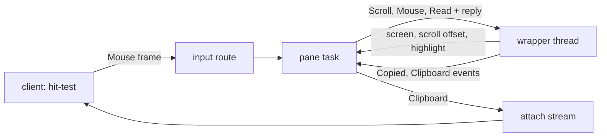
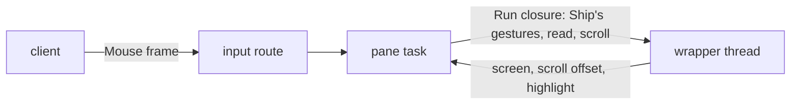
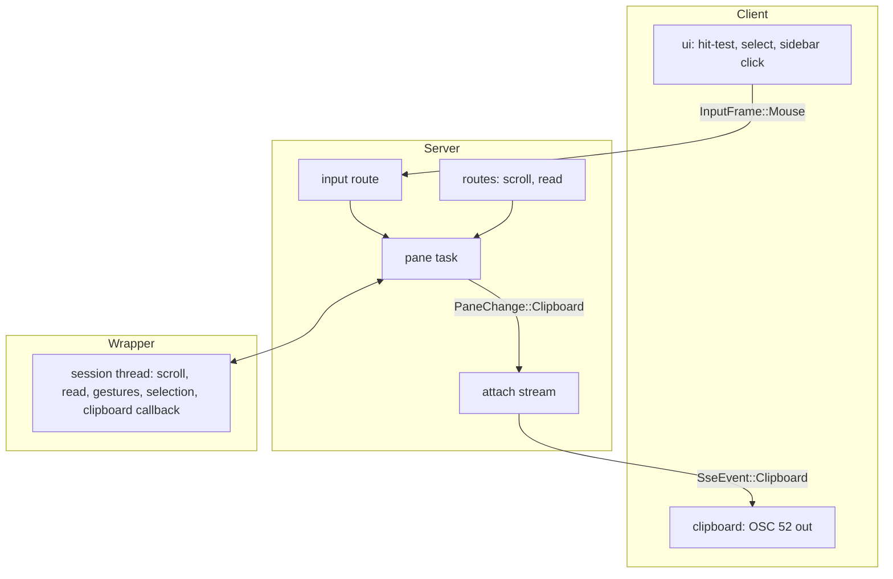

# Scrollback, mouse and edit-scrollback architecture

Status: Locked again on 2026-10-11, approved by Cyan in Plannotator review ("LGTM") after the product paper's amendment deferring edit-scrollback; deferred text is marked in place. Previously locked on 2026-10-11, approved by Cyan in Plannotator review ("LGTM") and in chat ("yep!"). Written on 2026-10-11 from the locked [product paper](product.md). Shape A was picked in chat: "all of the stuff that's in A actually belongs inside of [the wrapper]... if we need anything that doesn't belong in it, we could add B and use it as a fallback."

## Summary

Terminal mechanics go into the vendored wrapper as typed commands and events: scrolling, reading text, mouse gestures, selection drawing and clipboard writes. Ship's server routes them and owns what they mean: who gets a copy and which pane a command targets~~, and how edit-scrollback covers a pane~~. The client hit-tests mouse events, handles clicks that only select, and forwards the rest to the server in pane coordinates. The published screen already carries the selection highlight and gains a scroll offset. ~~A covered pane is stored inside the editor pane that covers it, in the layout tree's leaf.~~ (Deferred with edit-scrollback.)

Needs Cyan's attention:

- **Decision 2:** the wrapper's thread has to keep running after the program's PTY closes. Today it stops, so exited panes couldn't scroll or be read.
- ~~**Decision 10:** the covered pane lives in the editor pane's record (`covers`), not in a new layout node or a side map.~~ Deferred.
- **Decision 3:** two clients dragging in one pane at once share one selection; the last drag wins.

## Context and constraints

- Each pane's Ghostty terminal lives on the wrapper's session thread (`vendor/ratatui-ghostty/src/session.rs`, `session_thread`) and is reached only through the closed `SessionCommand` enum, which has no replies. Anything that asks the terminal a question needs a new command with a reply channel.
- The session loop exits when the PTY reader disconnects (`recv(pty_rx)`, `Err(_) => break`), so a pane's terminal is gone once its program exits. The pane task also drops every command after the exit is reaped (`pane.rs`, `PaneTask::command`).
- libghostty-vt at rev `8953a740` provides:
  - `set_selection`, which Ghostty tracks against its text, and a render state that reports each row's selected range (`render.rs`, `RowSelection`).
  - A `Gesture` with press, drag, release and autoscroll events, and its own repeat-click counting from event times.
  - `on_clipboard_write`, with OSC 52 already decoded. Clipboard reads never reach it.
  - `Data::MOUSE_TRACKING`, `scrollbar()` and `ScrollViewport`, plus the `Formatter` for plain, VT and unwrapped text.
- The wrapper already encodes mouse events against the program's live modes and falls back to scrolling the viewport on wheel buttons 4 and 5 (`session.rs` around line 537). It doesn't send arrow keys on the alternate screen, and it never draws a selection.
- The server already streams the screen of every pane in a client's viewed tab. Keys and pastes arrive on a one-way NDJSON stream (`input.rs`), whose route knows the sending attachment from its header.
- Panes live in the leaves of each tab's layout tree (`layout.rs`); there's no second pane map. Zoom already keeps hidden panes at their size (layout decision 6).
- `[server] shell` is re-read from the config file on every spawn (`pane.rs`, `PaneEnv::shell`).
- The protocol is at version 8. Implementation Rust is at 6,712 lines by cloc, against about 20k.
- The wrapper isn't a workspace member and doesn't count toward the budget. `PROVENANCE.md` records each change made to it; there are 11.

## Candidate shapes

### A. Typed wrapper commands (selected)

The wrapper gains commands for scrolling to a position and reading text with a reply, a fuller mouse handler (program first, then alternate-scroll arrows, then wheel scroll, then selection gestures), and events for a released selection and a program's clipboard write. It draws Ghostty's selection into its rendered cells and reports the scroll offset with each render. Ship's pane task forwards commands and turns events into clipboard deliveries. Cost: about five more wrapper patches to keep. Failure mode: copy mode and search later need more wrapper patches.

### B. One closure hatch (rejected)

The wrapper gains one `Run(closure)` command, plus the same drawing and event patches, and Ship writes gestures, reading and scroll rules as closures in `ship-server`. Cost: about 150 more counted lines, and Ship code bound to Ghostty's lifetime-heavy API. Failure mode: the closures also need the wrapper's PTY writer and mouse encoder, so the hatch exposes the wrapper's internals, not just the terminal.

## Decision

Shape A. Everything it adds to the wrapper is how a terminal behaves, which is what the wrapper is for, and it keeps Ghostty types out of Ship's code. B stays available as a later addition for anything that has to run on the terminal's thread but doesn't belong in the wrapper.

## Structure

| Box | Owns |
| --- | --- |
| Client `ui` | Which rectangle a mouse event hit, from published geometry. A click on an unselected pane or a sidebar row changes the client's selection (FR-010, FR-013). Other events in the selected pane go out as `InputFrame::Mouse` in pane coordinates. Mouse capture follows `[client] mouse`. |
| Client clipboard | Writes `SseEvent::Clipboard` text to its own terminal as OSC 52. |
| Input route | Turns `InputFrame::Mouse` into `PaneCommand::Mouse`, tagged with the sending attachment. |
| Routes | `server.pane.scroll` and `ship pane scroll`, and `ship pane read` (reply carries the text). ~~`ship pane edit-scrollback` (handed to the state actor).~~ |
| ~~State actor~~ (deferred, nothing new in it now) | Edit-scrollback: validate, read the history, write the temporary file, spawn the editor pane, commit it with `covers`. Uncovering when the editor pane closes, and the FR-019 split when the covered pane closes. Derives `ship pane get`'s covered and covering fields from the tree. |
| Pane task | Forwards commands. After the program exits, still forwards scroll, read and mouse, and drops keys, pastes and resizes. Publishes `Copied` to its attachment and `Clipboard` to every viewer. |
| Wrapper | Scroll, read, mouse routing and gestures, selection set, drawn and cleared, snapping to the bottom on input, alternate-scroll arrows, the history byte cap, and staying alive after PTY EOF. Nothing Ship-specific. |
| Attach stream | Delivers `SseEvent::Clipboard` to the attachment a copy is addressed to, or to every attachment whose viewed tab holds the pane. |

## Key decisions

1. **Terminal mechanics in the wrapper (shape A).** Rejected: a closure hatch (B), which exposes the wrapper's writer and encoder; and Ship owning the terminal directly, which moves about 800 wrapper lines into counted code.
2. **The wrapper outlives its program.** On PTY EOF the session loop stops reading but keeps serving commands until shutdown, so exited panes scroll, read and select (FR-008, ~~FR-014,~~ FR-029). The pane task forwards scroll, read and mouse after the exit, and drops keys, pastes and resizes as it does today. Rejected: caching the final text when the program exits, which loses scrolling and selection and duplicates history.
3. **Selection is Ghostty's, drawn by the wrapper.** Gestures set Ghostty's selection, and the wrapper's widget draws each row's selected range into the cells it renders, so every published screen carries the highlight and the protocol doesn't change for it (FR-025). One selection per pane: two clients dragging at once overwrite each other, and the last drag wins. The wrapper clears it on key or paste input; Ghostty drops it when its text is pruned. Rejected: publishing a selection range for clients to draw, which duplicates Ghostty's tracking and has to be recomputed on every scroll.
4. **Scroll offset on `Screen`.** `Screen` gains an optional offset from the bottom, read from `scrollbar()` at each render and absent at the bottom. Clients draw the indicator from it (FR-006). Rejected: a field on `Pane` in the replica, which would bump the shared revision on every wheel tick.
5. **The client hit-tests; the wrapper decides the rest.** The client resolves which pane, sidebar row or fold marker was hit, because those are client-local selection and published geometry. Inside the selected pane, whether an event goes to the program, scrolls, sends arrows or selects depends on the terminal's live modes, so the wrapper decides. Rejected: publishing a "wants mouse" flag for the client to decide on, which races the program's mode changes.
6. **Mouse on the input stream.** `InputFrame::Mouse { pane, event }` joins keys and pastes on the NDJSON stream, carrying crossterm's `MouseEvent` with pane-relative coordinates. The input route already knows the attachment and tags the command with it. Rejected: a separate request per event, which is too slow for drags and motion.
7. **Clipboard as an attach-stream event.** The pane task publishes `PaneChange::Clipboard { text, to: Option<attachment> }` on the bus. A copy on release goes to the attachment that made it (FR-024). A program's write goes to every attachment viewing the pane's tab (FR-026). The client writes with crossterm's `CopyToClipboard`, behind its `osc52` feature. Rejected: a crate like arboard on the server, which would copy to the server machine's clipboard, not the viewer's.
8. **Click timing on the server.** Ghostty's gesture counts repeat clicks from event times, and crossterm's mouse events carry none, so the wrapper stamps each press when it arrives. Rejected for now: a client timestamp in the frame, which only matters over a slow network.
9. **Autoscroll ticks in the wrapper.** While a drag is past the pane's edge, the session loop wakes on a short timer and applies Ghostty's autoscroll tick (FR-023). Rejected: a client-driven repeat, which would need the client to know the drag state.
10. **(Deferred with edit-scrollback.) The covered pane lives in the editor's record.** `Pane` gains `covers: Option<Box<Pane>>`, so the tree stays the one place panes live. Pane lookups and the live-pane map include covered panes. Geometry, sizes and swaps skip them, so a covered pane keeps its size, as zoom-hidden panes do. Uncovering replaces the leaf's pane with the covered one, keeping zoom (FR-018). Closing a covered pane clears `covers` (FR-019). Rejected: a `Layout::Covered` variant, which adds an arm to every match over the layout; and a tab-level side map, which the layout change already rejected for panes.
11. **(Deferred with edit-scrollback.) Edit-scrollback runs in the state actor.** Validate (FR-020), ask the pane task for the full unwrapped plain text, write it to a `0600` file in a per-server temporary directory, spawn the editor pane from `$VISUAL`, `$EDITOR` or `vi` with a jump-to-end argument for the vi family, then commit it with `covers`. The file's path stays on the editor's server-side runtime and is deleted when the editor pane closes, and the directory is deleted when the server stops (FR-022). Rejected: having the pane task spawn the editor, which would put tree edits outside the state actor.
12. **History cap at spawn.** `[server] scrollback_bytes` is read with `[server] shell` when a pane spawns. The wrapper's config takes a byte cap and no line cap (FR-005).
13. **Reads go through the pane task.** `PaneCommand::Read { lines, unwrap, ansi, reply }` reaches the wrapper's read command. The visible screen is read through the active area, so it ignores scroll position (FR-029); `--lines N` selects from the last N rows. ~~Covered and~~ Exited panes answer like any other.
14. **Protocol version 9.** New `InputFrame::Mouse`, `SseEvent::Clipboard`, and `Screen`'s scroll offset. ~~`Pane::covers`~~ is deferred.

## Risks and unknowns

- **Memory (U-2).** Fifty panes with full 10 MB histories is up to 500 MB, more if Ghostty's own accounting differs from the cap. Measure one full pane before slicing, and revisit the default if it's far off.
- **Long reads stall one pane.** Formatting 100k rows took about 25 ms in the probe, and that pane's output waits meanwhile. ~~Edit-scrollback and~~ `pane read --lines` on a huge history pays it once per call.
- **Wrapper drift.** This brings the wrapper to about 16 recorded changes. A libghostty bump means reapplying them; `PROVENANCE.md` keeps each one separately described for that.
- **Click timing over a network** (decision 8). Accepted by Cyan in review: a mouse frame is a few dozen bytes, so only jitter of hundreds of milliseconds could split a double-click.
- **OSC 52 size limits.** Some outer terminals drop large OSC 52 payloads; a huge selection may silently not copy. Known limitation, like U-1.
- **Size.** Estimated ~~450 to 550~~ 320 to 420 lines of implementation Rust in Ship after deferring edit-scrollback, which was about 130. That is below the product paper's 370 to 500 because gestures and formatting move into the wrapper, plus about 300 uncounted wrapper lines.
- **Rollback.** Each wrapper patch reverts on its own; the Ship side is new variants ~~and one model field~~.
