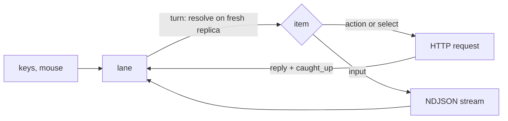
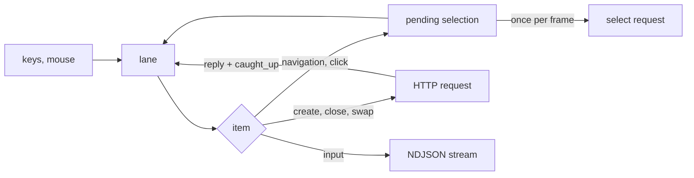
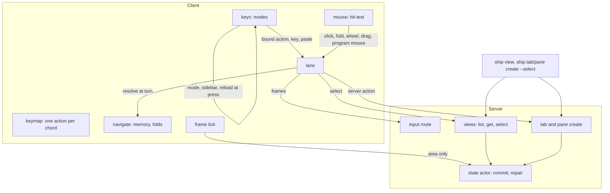

# Server-held selection and ordered input architecture

Status: Locked on 2026-10-13, approved by Cyan after Plannotator review ("LGTM! PROGRAM TIME"), which accepts decisions 6 and 8 as written. Written on 2026-10-13 from the locked [product paper](product.md). Shape A was picked in chat: "yeah A is simpler. let's keep it for this spec".

Amended on 2026-10-13 with product FR-018: decision 7 now derives `Binding` with `action` and `hint` fields and takes the fallback hint from `Action::hint`, named with `strum`. Approved by Cyan in chat ("yeah strum is exactly what i was thinking! let's update the papers please!"), with re-review waived ("don't worry about me checking them again. i'm sure they'll be correct").

Slice-1 amendment: Cyan explicitly waived strict list rejection. Keep derived `Binding` with no map-only guard; tables remain the documented syntax. See the product paper's recorded approval.

## Summary

The client gets one lane: a queue of everything the user does, run one item at a time. An item that edits the server waits for its reply and for the replica to catch up before the next item runs. Typed keys, pastes and mouse frames wait their turn the same way, but are sent without waiting for anything. Every target that depends on the selection is worked out when the item reaches the front, from the replica as it is then. Navigation becomes a call to a new select endpoint, shared with `ship view select`, and stops riding on the view PUT. Creates gain an optional attachment to select for, applied in the same commit. Bindings hold one action.

Needs Cyan's attention:

- **Decision 3:** the view PUT keeps only `area`, and selection gets its own endpoint, because anyone may set a selection but only the client sets its area. Agreed in chat ("fair enough. let's go for that then.").
- **Decision 6:** the client still sends its own unzoom before navigating, and the select endpoint's unzoom (FR-004) serves scripts and clicks. Two paths to one effect.
- **Decision 8:** disconnecting clears the whole lane, bound actions included, not only typed keys.

## Context and constraints

- `ui/mod.rs` `drive` (750 lines) already queues bound actions (`queued: VecDeque<VecDeque<Action>>`) and runs them while `running.is_none() && observer.caught_up(client.written())`. That gate is right; what's wrong is what bypasses it:
  - `Keys::handle` stamps typed keys and pastes with the selected pane at press and sends them at once (`Handled::Frame`).
  - Clicks set `chosen` or send a mouse frame directly (`Clicked::Select`, `Clicked::Frame`), and fold clicks toggle at once.
  - Navigation moves `chosen` without a round trip, and the frame tick PUTs it later.
- The view PUT (`PUT /attach/view`, `SetView`) replaces the whole record, selection and area together, latest wins (`unsent`). Any external selection would be overwritten by the next area change.
- Every server edit goes through `ServerState::commit(|tabs, viewers| …)`, which already has the viewers in hand, repairs every record and publishes one revision. Replies carry `x-ship-revision`, and `client.written()` tracks the highest seen.
- The repair rules (`repair`, `repair_removed`) move a removed selection to a neighbor or ancestor, and a zoom-hidden selection to the zoomed pane.
- Typed input travels on a separate NDJSON stream (`input.rs`) and is routed by pane ID with no reply. Actions are separate HTTP requests. Nothing orders the two across connections.
- `Command` (`ship-core/src/command.rs`) is shared by clap and the keymap's `server.*` actions; `execute.rs` fills missing targets from `Scope::Keys` (selection and tabs) or `Scope::Cli`.
- `Binding.actions: Vec<Action>`; `over_defaults` replaces a default per chord, and a binding with no actions unbinds.
- Protocol version 9. Implementation Rust is about 8,300 lines by `wc` (not cloc), against about 20,000.

## Candidate shapes

### A. Every step waits (selected)

The lane holds `Item::Action` and `Item::Input`. Gate: nothing running and the replica caught up to `client.written()`. At its turn an item is resolved against the current replica, client memory and folds. A server action, including the select a navigation turns into, starts a request and closes the gate until it replies and the replica catches up. Input resolves its pane and goes out on the NDJSON stream, and the next item runs straight away. `chosen` and the create special case go. Cost: one round trip per navigation step on a remote link, so holding a navigation key lags behind and keeps moving after release. Failure mode: a slow link makes key repeat feel sticky until Pipeline lands.

### B. Client-decidable steps don't wait (rejected)

As A, but navigation and clicks move a pending selection without waiting, and later items resolve against it. Selects go out once per frame, latest wins. The gate closes only for server calls whose result the client can't know: creates, closes, swaps. Cost: keeps `chosen` and adds a second kind of turn, plus the question of when a pending selection gives way to an external one. Failure mode: the client's idea of the selection and the server's disagree for a frame, and a script's select can be overwritten by a pending one.

### C. The lane as its own task (rejected)

The lane runs in a separate task fed by a channel, owning the HTTP client and the input stream. Cost: navigation needs memory, folds and zoom state, which `drive` owns, so the task would borrow or copy them, and mode changes still happen in `drive`. Failure mode: two owners of client-local state.

## Decision

Shape A. Correct type-ahead with one rule matters most here. It is the product paper's stated cost ("each dependent step waits a round trip"), and B's speed is a later change to one gate, not a reshaping.

## Structure

| Box | Owns |
| --- | --- |
| Keymap | One `Action` per chord, or none for `{}`, plus an optional hint. Strict list rejection is waived (FR-018 amendment). |
| Keys | The mode machine. Mode changes, sidebar toggle and config reload apply at press (FR-015). Everything else becomes a lane item, with no pane attached. |
| Mouse | Hit-testing against published geometry. Produces items that name what was hit: a pane, a sidebar row, a fold marker, or a frame for the pane's program. |
| Lane | The queue and its gate. At each turn: resolve, run, show any error and continue (FR-016). Cleared on disconnect (FR-017). Detach is an item, so it runs after everything before it. |
| Navigate | Unchanged logic (`navigate`, `Memory`, sidebar folds), now called at turn time on the current replica. Also picks a tab's landing pane for typed input (FR-005). |
| Frame tick | Sends the view PUT, area only, at most once per frame. |
| Views | `GET /views`, `GET /views/{attachment}`, `PUT /views/{attachment}/selection`. Select unzooms a hidden pane's tab in the same commit (FR-004). |
| Create | `CreateTab` and `CreatePane` take an optional attachment to select. The commit places the node and sets that record together, or fails as a whole (FR-007, FR-009). |
| State actor | Commits, repair rules and publishing, unchanged. |

## Key decisions

1. **One lane, shape A.** Every bound action, typed key, paste, `client.send`, click, fold click, wheel turn, drag and mouse frame for a program is an item (FR-012). An idle lane runs an item the moment it arrives, so there is no separate fast path for keys. Rejected: B (above); today's split, where actions queue and keys and clicks skip the queue.
2. **Resolve at turn, not at press.** Items carry what the user did, not a target. A key item is a chord and gets the selected pane at its turn; a click item carries the node that was hit and does nothing if it's gone (FR-013, FR-014). `Keys::handle` stops attaching a pane. Rejected: resolving at press, which is the bug.
3. **Selection gets its own endpoint; the view PUT keeps `area`.** `PUT /api/v0/views/{attachment}/selection` with `{ "selection": NodeId | null }`, used by both the lane and `ship view select`. `GET /api/v0/views` backs `ship view list`, and `GET /api/v0/views/{attachment}` backs `ship view selected`. `ViewInput` loses `selection`, so the frame tick never sends one; under shape A the lane is the client's only writer of its selection. The two fields have different writers: anyone holding the attachment ID may set the selection, but only the client itself sets its area, the size of its own terminal. Rejected: keeping both on `PUT /attach/view` as optional fields, which works but lets a script send an area, and makes `selection` three-valued (absent keeps it, `null` clears it, an ID sets it).
4. **Input items don't close the gate.** A key, paste or mouse frame is written to the NDJSON stream at its turn and the next item runs at once, so an idle lane types as fast as today (P1). Accepted gap: a server action can reach the server before frames written just before it, because they use different connections (product Non-goals). Rejected: waiting for input to be acknowledged, which needs a reply channel on the stream, which is Pipeline.
5. **Create selection inside the commit.** The command structs gain `select: bool` and `attachment: Option<IdOf<Attachment>>` (clap `--select`, `--attachment`, env `SHIP_ATTACHMENT_ID`). `execute` fails before any request when `select` has no attachment (FR-008); keys fill the attachment from the observer. The request body carries `select: Option<IdOf<Attachment>>`; the server checks the record exists inside the commit, so a missing one fails before anything is placed, and the starter's runtime is dropped as on any failed commit (FR-009). A tab with a starter selects its pane. Rejected: create then select as two calls, which shows a moment where the tab exists unselected.
6. **Unzoom stays on the client for navigation.** Focus, swap and next/prev on a zoomed tab still push an unzoom ahead of themselves, because finding the neighbor needs the unzoomed geometry, which is only published after the unzoom. The select endpoint unzooms on its own for scripts and clicks (FR-004). Rejected: computing unzoomed geometry on the client from `geometry::tab`, which duplicates what the server derives and would need the tab's size.
7. **Bindings hold one `Action`, by name.** `Binding { action: Option<Action>, hint: Option<String> }` with derived `Deserialize` and `deny_unknown_fields`. `{}` leaves both unset and unbinds; a stray key fails with the config error's line and column. Serde's incidental acceptance of positional lists is left alone, per Cyan's slice-1 amendment. An unset hint falls back to `Action::hint`, whose verbs come from `strum::IntoStaticStr` on the action enums, so they match the config's own names. `action_hint` and the hand-written deserializer go. `over_defaults` keeps replacing per chord. The `creates` special case and per-binding cancellation go away. Rejected: keeping the bare-table syntax, which needs the raw TOML for the hint and so a hand-written deserializer.
8. **Disconnect clears the lane.** Bound actions, keys and clicks not yet run are dropped with the connection, as keys are today, and a request in flight is abandoned. The reconnect attaches with the last recorded selection (FR-006). Rejected: keeping bound actions across a reconnect, which could run them against a restarted server.
9. **Protocol version 10.** `ViewInput` shrinks, creates gain `select`, and the views endpoints are new.

## Risks and unknowns

- **Key repeat over a slow link.** Holding `alt-j` at 30 repeats a second over a 100 ms round trip queues three times faster than it drains, and keeps moving for as long after release. If this feels bad in use, the fix is B's pending selection or Pipeline, both changes to the gate. No cap on the lane is planned.
- **Area PUTs slow the gate slightly.** Each area PUT bumps the revision the gate waits for. Only matters during a terminal resize.
- **Two unzoom paths** (decision 6). If the client's unzoom and a select's unzoom ever disagree, the server's wins on the next publish.
- **SC-001 needs a delaying proxy.** Nothing in the repo adds latency between client and server. The program paper has to pick one or write a small one before SC-001 can be checked.
- **Size.** Unmeasured. Removed: `chosen`, `putting`'s selection, `unsent`'s selection, the `creates` path, `Scope::Keys` tabs, nested binding lists. Added: the lane, three views routes and their actor messages, `ship view`, the create `select` field. Guess: within 150 lines either way.
- **Rollback.** The lane is client-only. The protocol changes are additive except `ViewInput` losing `selection`, which the version bump covers, since client and server upgrade together.
