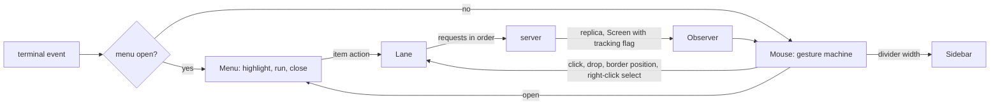
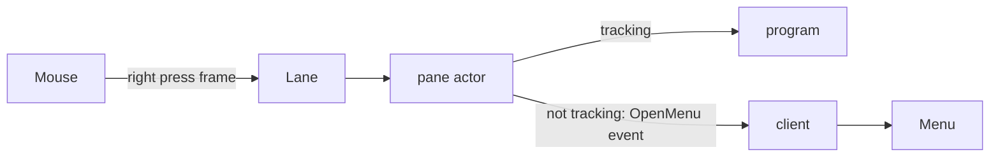
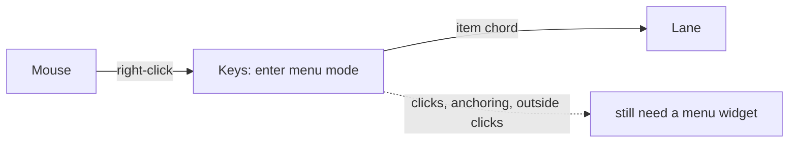
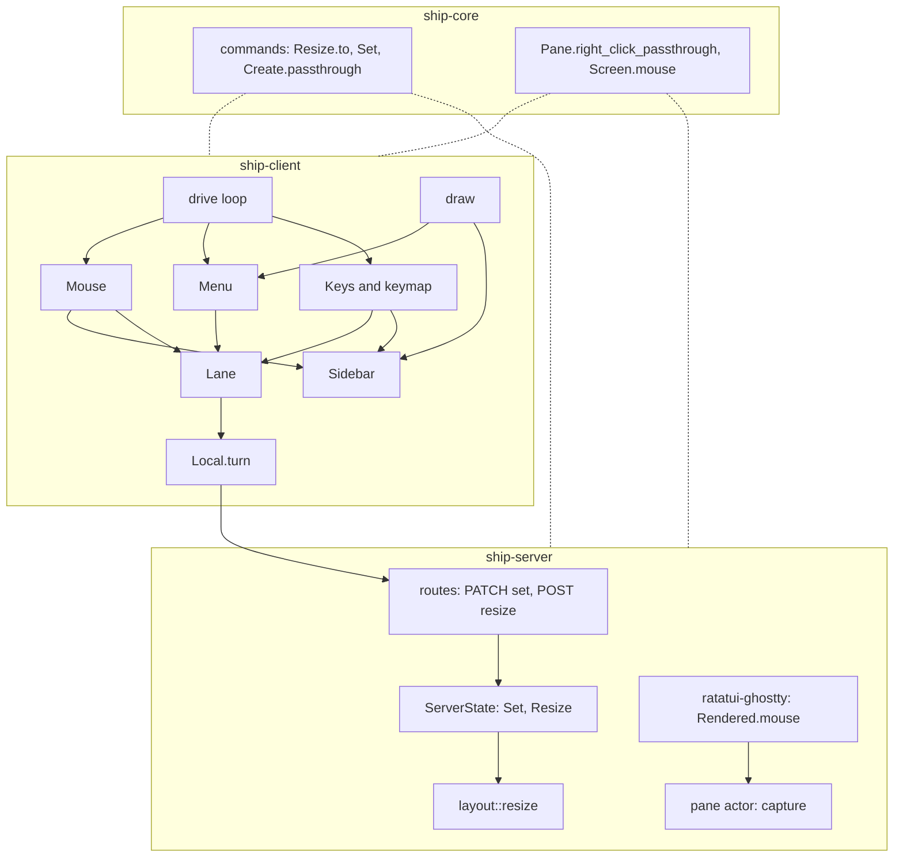

# Mouse drag and menus: architecture

Status: Locked on 2026-10-13, approved by Cyan in Plannotator review ("LGTM! I agree with A being the pick!"). Written the same day against the locked [product paper](product.md). The approval doesn't authorize implementation; Cyan requests that separately. The superseded mouse-drag architecture draft was read for ideas; its drop-line drawing, depth rule, sidebar width override and `to` exclusivity carry over (Key decisions 6, 7, 8 and 14), and its frame-tick resize sender doesn't, because the product now puts border drags in the lane.

## Context and constraints

- **The lane.** `ui/lane.rs` holds every input as an `Item` (`Action`, `Key`, `Paste`, `Select`, `Fold`, `Mouse`) in one queue. `next` hands out an item only when nothing is running and the replica has caught up to the client's last write (`observer.caught_up(client.written())`). An item's turn returns `Done`, `Wait(request)`, `First(items)` or `Detach`.
- **The drive loop.** `ui/mod.rs` `drive` is one `tokio::select!` over the attach stream, terminal events, the lane's running request, config saves, the area-only view PUT (`putting`, paced by the 16 ms `FRAME` tick) and signals. Client-local state lives in `Local`: observer, memory, sidebar, keys, mouse, the input channel and the status message. Mode, sidebar and reload actions apply at press (`Handled::Now`) and skip the lane; everything else is queued.
- **The mouse router.** `ui/mouse.rs` `Mouse::route` (109 lines) maps one crossterm event to `Clicked::{Select, Fold, Frame}` and remembers only the pane a press started in. Sidebar presses act at press. A press on a pane that isn't selected, or on any pane while the lane is busy, selects it. Program input goes only to the selected pane, except the wheel.
- **Geometry.** The server publishes `TabGeometry` per viewed tab: each pane's `frame` and `content`, relative to the tab. With two or more panes, adjoining frames share their border cells, so a border cell lies in two or more frames and in no content. Labels are drawn on each frame's top row from column 1.
- **Sidebar.** `ui/sidebar.rs` draws a `tabs` title, a blank row, then a tui-tree-widget tree with a 2-column indent and a right divider column. `row_at` maps a position to a row and its fold marker. `width` is overwritten from config on every reload.
- **Keymap.** `keymap.rs` deserializes `[client]` with `deny_unknown_fields`, merges the file over `keymap/defaults.toml`, and derives each binding's hint with `Action::hint`. `Binding` is `{ action?, hint? }`.
- **Server.** `ServerState` (`state.rs`) is one kameo actor; `commit` applies an edit, bumps the revision and publishes. `layout::resize` already turns an amount into an absolute target length, finds the furthest target that keeps every pane at 1x1 content, and stores a ratio. Renames already go through `PATCH /api/v0/tabs/{id}` and `PATCH /api/v0/panes/{id}` with a `{ name }` body.
- **Screens.** Each pane actor publishes a `Screen` (cells, cursor, scroll offset) through its own watch channel, at most once per frame. Whether the program tracks the mouse is known only inside the vendored `ratatui-ghostty` session, which forwards pointer input when `terminal.is_mouse_tracking()` and otherwise uses left drags for selection and drops other buttons. The vendored crate is a workspace member Ship already patches.
- **Hard limits from the product paper.** Server and `ship-core` changes are limited to `to` on resize, the passthrough setting, `set` replacing `rename`, and whatever publishes mouse tracking (SC-005). The client draws only published layout (FR-011). About 650 to 900 client lines and 100 to 160 server and core lines (SC-006).

## Candidate shapes

### A. The client decides; the lane carries every effect (winner)

The router grows into a small gesture machine that tells clicks, drags and right-clicks apart. Every effect on the server becomes a lane item: border positions (coalesced in place), tab drops, menu actions and the selection a right-click makes. Open menus and sidebar width stay client-local. The server publishes whether each pane's program tracks the mouse on that pane's `Screen`, so the client can decide passthrough versus menu at press without a round trip. Cost: one new client module for menus, a gesture enum in the router, three new lane items, one boolean on `Screen`. Failure mode: the router mixes click and drag paths badly; the tracking flag can lag a mode change that doesn't redraw (Risks).

### B. The server decides passthrough

The client sends every right-press on a passthrough pane to the server as input. The pane actor forwards it when the program tracks the mouse and otherwise emits a new SSE event telling that attachment to open the pane menu. Nothing new is published per frame, but the server learns that clients have menus, a new event type crosses the boundary, and the menu opens a full round trip after the click, which SC-004's "on the frame after" can't meet remotely. Rejected.

### C. Menus as a synthesized key mode

An open menu is a temporary mode whose bindings are the items, so `Keys` handles navigation and the status line shows the items as hints. It reuses the most code, but mouse clicks on items, anchoring at the pointer and the "click outside goes nowhere" rule all live outside `Keys` anyway, and mode semantics (sticky, oneshot, `esc` bindings, hint order) would leak into menus. Cyan rejected menus-as-mode during the product interview. Rejected.

## Decision

**A.** What matters most is that every server effect keeps its place in the one ordered lane while menus open instantly; B gives up instant menus and leaks client presentation into the server, and C reuses keymap code at the cost of bending modes around something that isn't one.

## Structure

| Box | Owns |
| --- | --- |
| `Mouse` (`ui/mouse.rs`) | The gesture: a pending press with its origin and what it hit, the one-cell threshold, and at most one live drag (border edges, divider or row). Hit-testing borders from published frames. Deciding, for a right press, between passthrough, a menu target, or today's behavior when that target's list is empty. |
| `Menu` (`ui/menu.rs`, new) | One open menu: its target, its items copied from settings, the highlight and its on-screen rectangle. Keys and clicks while open. Drawing it last, over everything. |
| `Sidebar` (`ui/sidebar.rs`) | The configured width and a client-local override; the heading and its menu button as hit areas; the drop target and depth for a pointer position during a row drag; drawing the drop line. |
| `Lane` (`ui/lane.rs`) | Order, as today, plus replacing a waiting border position for the same edge in place. |
| `Local.turn` (`ui/mod.rs`) | The new items' turns: a border position becomes `pane resize --to`; a drop is re-checked against the replica, then becomes `tab move`, then unfolds the new parent; a gone target ends quietly. |
| Keymap (`keymap.rs`, `defaults.toml`) | `[client.menus]` parsing, defaults and per-target replacement; item labels from `Action::hint`; `client.sidebar.resize`. |
| `draw` (`ui/draw.rs`, `ui/panes.rs`) | The held border's color, the drop line, the heading button and the open menu. |
| `ship-core` | `to` on `pane::Resize` and `ResizePane`; `tab::Set` and `pane::Set` replacing `Rename`; the tri-state on/off/toggle value; `right_click_passthrough` on `Pane` and on pane create; `mouse` on `Screen`. |
| `ServerState` | `Set` for tabs and panes, resolving toggle against the stored value and committing only on change; `Resize` choosing its target from `amount` or `to`. |
| Pane actor and `ratatui-ghostty` | Reporting mouse tracking with each rendered snapshot, copied onto the published `Screen`. |

## Key decisions

1. **Gestures, not events, in the router.** A left press on a border, the divider or a sidebar row becomes a pending press; motion of a cell or more turns it into a drag, and a release before that is a click (FR-001). Sidebar clicks therefore emit `Select` or `Fold` at release (FR-005). Presses on pane contents keep today's immediate path, since text selection there is the program's or the vendored session's own drag. Rejected: deciding click versus drag in `drive`, which would spread the state across the loop.

2. **Border hit-testing from published frames.** A cell inside two or more pane frames and inside no content is a border. Each border cell yields at most one vertical and one horizontal edge, named by the pane left of or above it and the direction `right` or `down` (FR-009); a junction yields both (FR-006). This check runs before the pane-selection branch, so a border press never selects, even while the lane is busy (FR-007). Rejected: naming splits by layout path, which breaks when the layout changes mid-drag.

3. **Border positions are lane items, coalesced in place.** Each motion that changes the position along an edge's axis produces a resize item for that edge with an absolute `to`. If an item for the same edge is still waiting, the lane overwrites it where it stands instead of queueing another (FR-010); positions are absolute, so overwriting is always safe. An item takes its turn like an action: request, reply, wait for the replica. The final position goes in on release if it differs from the last one queued. Rejected: replacing only when it's the last item, which lets a key typed mid-drag leave two positions waiting; and the superseded per-frame sender, which the product now forbids.

4. **A gone pane ends the drag quietly.** On each motion the router checks that the edge's pane is still in the replica and ends the drag if not; at its turn, a resize for a pane that has gone is dropped with no error (FR-009).

5. **Drops resolve twice.** At release the client turns the drop line into a `Destination` (before a sibling, after a sibling, or under a parent) and queues a drop item. At its turn the item is re-checked against the replica: every named tab still exists, the target isn't in the dragged tab's subtree, and the move isn't a no-op; otherwise it ends with no error (FR-024). Then it runs `tab move`, and on success unfolds the new parent in this client (FR-025). Rejected: a plain `Item::Action` for the move, which would show the server's not-found or structure error.

6. **The drop line is an underline on the row above the gap**, from the target depth's indent to the divider; the gap above the first row uses the blank row under the title. Rejected: inserting a blank row, which shifts the rows under the pointer.

7. **Depth range at a gap runs from the row below's depth (0 after the last row) to one more than the row above's** (FR-020). The pointer's column in 2-column steps picks the depth and is clamped to the range. The deepest depth means "child of the row above": before its first child when it has visible children, otherwise appended under it. A shallower depth means "after the row above's ancestor at that depth".

8. **Sidebar width keeps the configured value and an optional override.** The divider drag and `client.sidebar.resize` both set the override through one clamp (FR-015); a reload drops the override only when the configured value changed (FR-016). `client.sidebar.resize` applies at press with the other sidebar actions. The new width reaches the server through the existing area-only view PUT. `client.sidebar.resize` takes its own `left`/`right` direction, so `up` fails at config load.

9. **Menus are client-local overlays owned by `Local`.** At most one is open. While it's open, `drive` gives every key and mouse event to it first (FR-035); nothing reaches `Keys`, the router or a pane. Running an item queues its action exactly as a key binding would, including the press-time path for mode, sidebar and reload actions (FR-036), then closes the menu. Rejected: B and C above.

10. **A right-click is a select item, then a menu.** For a pane or tab target, the press queues `Select` for the target, as a left click would, and opens the menu at once; items picked later queue behind that select, so they act on the clicked target (FR-032). The global menu queues nothing. When the target's list is empty, the router takes today's path instead, so the router reads which targets have menus (FR-033).

11. **Passthrough is decided by the client at press, from published state.** A right press on pane contents goes to the program when the pane's `right_click_passthrough` is on and that pane's latest `Screen` says the program tracks the mouse. It is sent to that pane as mouse input without selecting it, and the router holds the pane so the drag and release follow (FR-038). Otherwise it's a pane-menu right-click.

12. **Mouse tracking rides on `Screen`, not on `Pane`.** The vendored session records `is_mouse_tracking()` in each rendered snapshot; the pane actor copies it onto `Screen` as `mouse`, omitted when false. Tracking is terminal mode, changes with program output and only matters to clients drawing that pane. Rejected: a field on `Pane` in the replica, which would bump the shared revision whenever a program toggles mouse mode and make the lane wait on it; and B above.

13. **`set` reuses the rename routes.** `PATCH /api/v0/tabs/{id}` and `/panes/{id}` already change a name; their bodies become patch objects with every field optional, where an absent field leaves the attribute alone and a blank name clears it. `ServerState`'s `Rename` messages become `Set`, which resolves toggle against the stored value inside the actor and commits only when something changed (FR-040, FR-041). The CLI's `rename` subcommands and the `Rename` command variants go away (FR-042). The on/off/toggle value is one `ship-core` type shared by the config, the CLI and the HTTP body, written `true`, `false` or `"toggle"`. Rejected: new routes beside the PATCH ones; and `double_option` for names, since `""` already means clear.

14. **`to` is exclusive with `amount`** on the CLI (clap conflict, exit 2) and in the HTTP body (validation error). In `layout::resize`, `to` replaces the computed target length and the existing clamp search runs unchanged (FR-008).

15. **Defaults live in `defaults.toml`.** `[client.menus]` sits beside the default modes; a file's target replaces that whole list, and `deny_unknown_fields` makes an unknown target or item key a config error with its location (FR-027, FR-028). Labels fall back to `Action::hint`.

## Risks and unknowns

- **Tracking flag lag.** The flag updates when the session renders. A program that turns on mouse mode without drawing anything leaves the flag stale until its next output. Most programs draw when they start, so this is unlikely to matter; if it does, the pane actor can mark the session dirty on mode changes. Checked at the program stage against Neovim and `less`.
- **Resize latency on slow links.** Each border position waits for its reply and the replica, so with 100 ms each way the border trails the pointer by about two round trips and then settles (SC-002). Coalescing keeps the backlog at one per edge.
- **Off-by-one in `to`.** `layout::resize` measures the first side including its shared border cell, so converting "border drawn at column N" into its target length needs checking against `ship pane get`.
- **Menu over the status line.** A menu near the bottom may cover the status line. Drawing the menu last is intended; noted so it isn't mistaken for a bug.
- **Underline visibility.** Faint underlines in some terminals or fonts could hide the drop line; reverse video on the same cells is the fallback, a drawing-only change.
- **Drag reporting.** Drags need button and motion reporting, which `EnableMouseCapture` turns on. Terminals that ignore it won't drag; record them under SC-001.
- **Router growth.** If `mouse.rs` gets hard to read, splitting border and row hit-testing into a sibling module is a program-stage choice, not a shape change.
- **Size.** Menus are the least certain part of SC-006. If the menu module passes about 250 lines, revisit before continuing.
