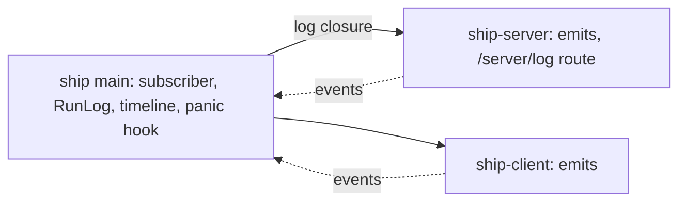
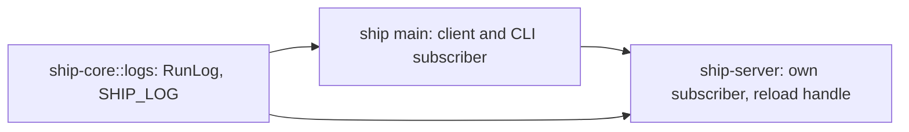
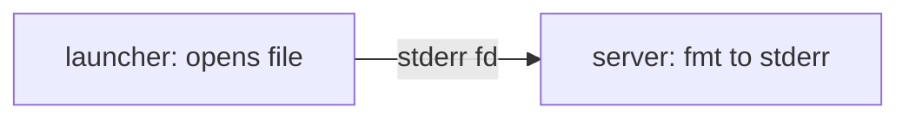
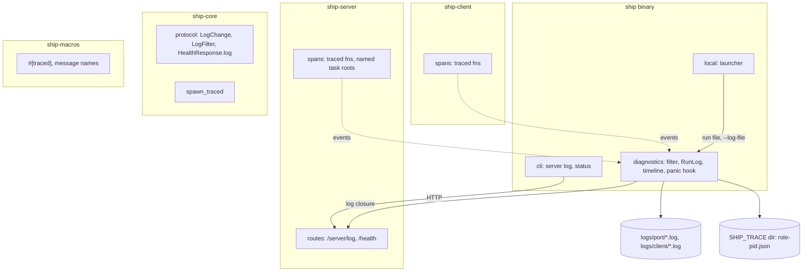

# Diagnostics architecture

Status: Locked on 2026-10-15, approved by Cyan in chat after Plannotator review ("architecture paper LGTM!"); the review didn't submit from the browser. The approval doesn't authorize implementation. Written on 2026-10-15 from the [product paper](product.md), which was locked again after cutting pane recording. Shape A was picked in chat: "that way the server doesn't have to care about anything except the one functionality it exposes to change the log level. everything else is configured by the runner instead."

## Summary

The `ship` binary, the runner, sets up all logging for every role: the server, the full-screen client and one-shot CLI commands. It picks the filter, opens the log file, adds the timeline and installs the panic hook. Ship's library crates only emit tracing events and spans, like every dependency does. The one exception is the live level change: the subscriber can only be changed through a handle that exists where it was built, so `main` hands `serve` a single closure that shows, sets and resets the filter, and the server's `/server/log` route calls it.

Needs Cyan's attention:

- **Decision 2:** log lines are written synchronously, not through tracing-appender's background writer. In chat I recommended the background writer; it loses queued lines on SIGKILL, and on any panic in release builds, which use `panic = "abort"`. That breaks SC-002 and FR-007.
- **Decision 6:** the closure also reports the current log file, so `ship server status` gets its path from the same place.
- **Risk "Chains stop at actors":** kameo starts each message's span as a new root, so an error inside an actor shows the actor's chain but not the request that sent the message.

## Context and constraints

- `crates/ship/src/diagnostics.rs` `init()` builds `tracing_subscriber::fmt()` with an `EnvFilter` from `RUST_LOG` (default `info`) on stderr. `main.rs:39` calls it for every command.
- `crates/ship/src/local.rs` `default_health()` launches the background server with `--background-child`, redirecting its stdout and stderr into a random `$TMPDIR/ship-server-XXXX.log` from `tempfile` (mode 0600). The path is shown only if the launch fails.
- tracing appears as one span (`request`, `ship-server/src/lib.rs`) and about 13 events. `ship-client` has no tracing dependency. `ship-core` has tokio only behind its `kameo` feature.
- kameo 0.22.2 emits `actor.handle_message` at info with `parent: None` and `actor.lifecycle` around each actor. Message names default to `type_name`, overridable through `Message::name()`.
- `EnvFilter` matches targets by prefix, so `ship` covers every `ship_*` crate. A `reload::Layer` works as a per-layer filter in tracing-subscriber 0.3.23.
- tracing-appender 0.2.5 rotates by time only and prunes by file count. tracing-chrome 0.7.2 writes Chrome trace JSON through its own thread and flushes when its `FlushGuard` drops.
- Release builds use `panic = "abort"`.
- `HealthResponse` is `{service, protocol_version, version}`; the protocol is at version 12.
- Implementation Rust in `crates/` is 8,707 lines by cloc, inline tests included, against about 20k.
- This machine is macOS. Linux behavior, including symlinks and permissions, is unverified here.

## Candidate shapes

### A. The runner owns the subscriber (selected)

`ship`'s `diagnostics` module builds the subscriber for the role it's running: file plus stderr for a foreground server, file only for a background server or a full-screen client, stderr only for one-shot commands, plus the timeline when `SHIP_TRACE` is set. Library crates only emit. `serve` gains one closure parameter for the log route. Cost: one extra argument on `serve`. Failure mode: a second runtime-tunable setting would need its own closure.

### B. The server owns its logging (rejected)

`serve` builds the server's subscriber itself and keeps the reload handle in `AppState`, with the shared pieces (`RunLog`, the `SHIP_LOG` mapping) in `ship-core` behind a feature. `main` still sets up the client and CLI. Cost: ship-server and ship-core depend on tracing-subscriber, tracing-chrome and the writer; two places build subscribers. Failure mode: anything logged before `serve` runs misses the file.

### C. The launcher owns the file (rejected)

Processes keep printing to stderr; the launching `ship` points stderr at a stable file. Cost: almost nothing. Failure mode: no rollover or retention while the server runs, a foreground server writes no file, and the client has nowhere to write. It fails FR-003, FR-005 and FR-006.

## Decision

Shape A. What matters most is that the server stays a library that only emits, as Ship's dependencies do, with the runner deciding where output goes. A gets that and needs only one closure to cross into `serve`. B spreads subscriber setup over three crates, and C can't meet the file requirements.

## Structure

| Box | Owns |
| --- | --- |
| `diagnostics` | Building the subscriber per role. The `SHIP_LOG` to filter mapping and `RUST_LOG` override. The reloadable filter and the closure over it. `RunLog`: 0600 files and directories, start-time names, `.2.log` parts at 5 MiB, `current.log`, 200 MB retention per directory. The timeline layer and its flush at clean exit. The panic hook. |
| `local` | Opening the background server's run file through `RunLog` before launch, pointing the child's stdout and stderr at it, passing its path, and naming it when the launch fails. No temp file. |
| `cli` | `ship server log [level \| --filter F \| --reset]`, turning a level into a filter string with the same mapping as `SHIP_LOG`. `ship server status` printing the log path. |
| ship-server routes | `/api/v0/server/log` showing or applying a change through the closure. `/health` filling in the log path from it. Nothing else about logging. |
| Spans | `#[traced]` on non-trivial functions, finer levels on hot ones. Named root spans for long-lived tasks: the pane task, the pane-exit thread and the event forwarder. |
| ship-core | The protocol types and version 13. `spawn_traced` is always available; it does not depend on Kameo (Cyan’s slice-2 revision). |
| ship-macros | `#[traced]` and the attribute that names actor messages. |

## Key decisions

1. **The runner builds the subscriber; the server takes one closure.** `serve` gains `log: impl Fn(Option<LogChange>) -> Result<LogFilter>`, where `None` shows and `LogChange` is `Set(filter)` or `Reset`. `main` implements it over the `reload::Handle` and the startup filter it built. Rejected: the server building its own subscriber (B); a struct of closures or a trait, which is the same capability with more names; and `main` adding the route to the server's router, which splits the route from the rest of the API and its OpenAPI docs.
2. **A Ship-owned `RunLog` writer, written synchronously.** `RunLog` implements `io::Write` behind a mutex and is the fmt layer's writer. Each event is one `write` on the emitting thread, so a line is in the kernel before the call returns and survives SIGKILL and an aborting panic (SC-002, FR-007). Rotation, `current.log` and pruning happen inside `write` when a part fills. Rejected: tracing-appender's `RollingFileAppender`, which can't rotate by size or prune by bytes; and its `non_blocking` writer, which drops queued lines on SIGKILL and on abort. Cost: a write per event on the caller. At the default info level hot paths emit nothing (SC-001); debug is opt-in.
3. **The launcher opens part 1.** `local` opens the run file through `RunLog` (pruning and moving `current.log`), redirects the child's stdout and stderr to it, and passes a hidden `--log-file <path>`. The child's `RunLog` continues that file. Output from before setup, including Zig or allocator aborts, lands in part 1. Raw stderr stays on part 1 after rollover; panics go through the hook into the current part. A foreground server opens its own run file. Rejected: the child opening the file itself, which loses anything printed before setup.
4. **The panic hook logs through tracing.** It emits the panic and its location as an error event, then calls the default hook. With synchronous writes (decision 2) the line is on disk before the abort. A full-screen client's hook also restores the terminal, as today.
5. **One reloadable filter on the outputs, a fixed one on the timeline.** The file and foreground stderr layers share a per-layer `reload::Layer<EnvFilter>`. The timeline layer has its own fixed filter, `warn,ship=debug,ratatui_ghostty=debug,kameo=info`, so it records at debug whatever the level (FR-018) and a level change never touches it. Rejected: one global filter, which would gate the timeline by the log level.
6. **The closure also reports the file.** `LogFilter` is `{ active, startup, file }`, with `file` the part being written. `/health` calls the closure to fill `HealthResponse.log`, so status always names the current part. Rejected: passing a fixed path to `serve`, which goes stale at the first rollover.
7. **Levels map in one function.** `SHIP_LOG=L` becomes `warn,ship=L,ratatui_ghostty=L,kameo=X`, with X `info` at debug or trace and `warn` otherwise; unset means info. `RUST_LOG`, when set, is used as is. `ship server log L` sends the same mapping as a `Set` filter, so the server only sees full filter strings and validates them before applying (FR-015). A background server inherits both variables through the launcher's environment.
8. **`#[traced]` wraps `tracing::instrument`.** Defaults: `level = "debug"`, `skip_all`, and `err(level = "warn", Debug)`; `no_err` turns default error logging off, `level` overrides the default, and all other options pass through unchanged for `tracing::instrument` to validate (Cyan’s slice-2 revision). `skip_all` keeps arguments out unless named in `fields`, which prevents automatic recording of terminal payloads, full argument lists and environments (FR-010). With Cyan's slice-2 approval, explicit failure diagnostics retain useful program names and dependency error details; this is not a guarantee that logs contain no sensitive information. Errors log with Debug, matching `ResultExt`. Rejected: tracing-error's `SpanTrace`, since an error logged inside its spans already prints the chain (FR-016).
9. **Spans across tasks.** `spawn_traced(fut)` spawns `fut.instrument(Span::current())` for short tasks tied to their caller, such as `attach.rs`'s detach on drop. Long-lived tasks get their own named root spans instead, because parenting them to whatever spawned them would chain every later event to a finished request.
10. **Actor messages named at the source.** A ship-macros attribute on `impl Message<X>` fills `name()` with `X` as written, so kameo's spans read `Resize`, not the full type path. Rejected: a layer that renames spans after the fact.
11. **Timelines from tracing-chrome.** With `SHIP_TRACE=<dir>`, `diagnostics` adds a chrome layer writing `<dir>/<role>-<pid>.json` in the threaded style, with span fields included, and drops its `FlushGuard` when `main` returns. Without the variable the layer isn't built (FR-019). A crash leaves no timeline, as the product paper allows.
12. **Protocol version 13.** New `LogChange` and `LogFilter`, the `/server/log` route, and `HealthResponse.log`.

## Risks and unknowns

- **Chains stop at actors.** kameo opens `actor.handle_message` with `parent: None`, so an error inside an actor shows the actor's spans and not the HTTP request that sent the message. FR-016 is met within the actor. Linking the two needs the sender's span carried in each message; out of scope unless the logs show it's needed.
- **Debug-level cost.** Synchronous writes at debug on the typing path add a write per event. Only the default level is benched (SC-001). If debug feels slow, a buffered writer with a flush on panic is the fallback, at the cost of decision 2's SIGKILL guarantee.
- **Repeated error lines.** An error logged by several traced layers appears once per layer. `no_err` on outer layers trims it if it gets noisy.
- **Raw stderr after rollover.** A Zig or allocator message printed after the first rollover lands in part 1, not the current part. Rare, and part 1 is kept until retention removes it.
- **Platforms.** Symlinks and 0600 permissions are checked on macOS only; Linux is unverified here. On Windows, `current.log` is skipped where links fail and the state directory falls back to the local data directory.
- **Size.** About 400 to 450 lines of implementation Rust, above the product paper's 200 to 300: `#[traced]` is about 120 of them, `RunLog` about 80, subscriber setup and the level mapping about 75, the route, closure and protocol about 50, the CLI about 30, message names about 30, and span annotations about 40. Tests are counted separately.
- **Rollback.** The library crates only gain annotations and one route, so reverting `diagnostics` restores today's stderr logging. The protocol bump stays.
