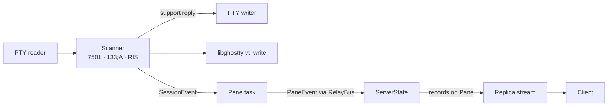
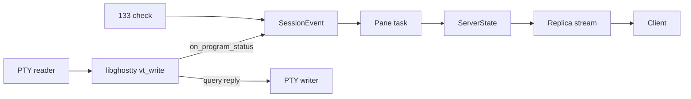
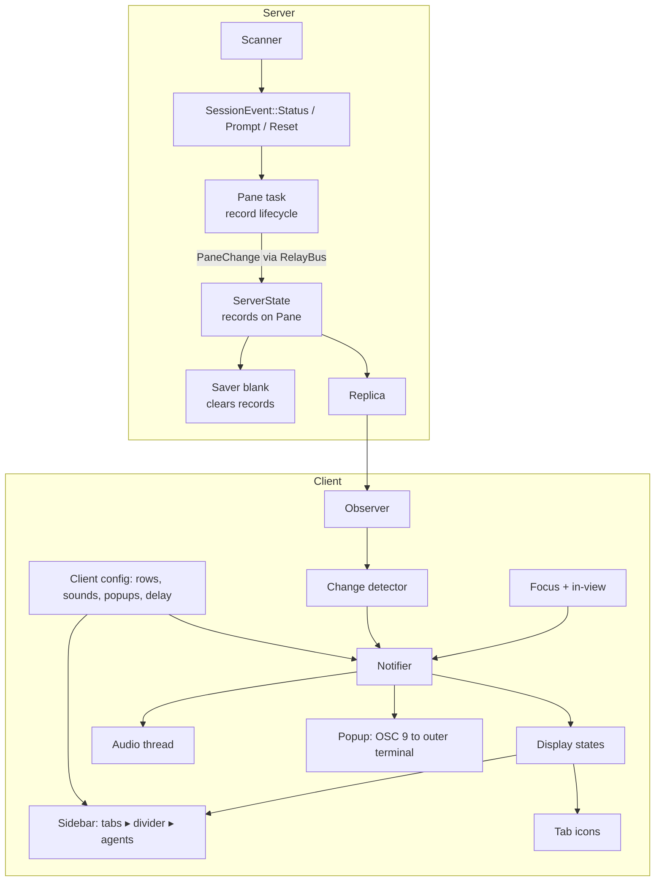

# Program status: architecture

Status: Locked on 2026-10-18 with Cyan's approval (Plannotator "LGTM", then "i looked at it" on the revised text). Reopened the same day to correct key decision 3 (the OSC 133 check is temporary) and relocked with Cyan's approval (Plannotator "LGTM"). Corrected the same day at Cyan's request to name `ship tab list`, which prints every pane, in place of `ship pane list`, which doesn't exist. Implements the locked `product.md` beside it. Locking doesn't authorize implementation.

## Context and constraints

- PTY output reaches libghostty at exactly one point: `state.terminal.vt_write(&batch)` in the session thread of the vendored `ratatui-ghostty` (`vendor/ratatui-ghostty/src/session.rs`). The same thread owns the PTY writer that libghostty uses for its replies, such as answering DA1.
- Ship pins libghostty-rs at `d2036ba`, which builds Ghostty `3425025`. That predates Ghostty's OSC 7501 support (ghostty-org/ghostty#14560 and #14630). No libghostty-rs work toward a binding is visible. The pin also has no callback for OSC 133 prompts or for RIS.
- Session callbacks push `SessionEvent`s. Each pane has a **pane task** (`PaneTask` in `crates/ship-server/src/pane.rs`), a tokio task that owns the session. Its paced `publish` drains the events in order once per frame. It keeps small per-pane state (the frame's title, the last published directory) and sends a `PaneEvent { pane, change: PaneChange }` on the `RelayBus` actor. The `ServerState` actor's `Message<PaneEvent>` handler (`crates/ship-server/src/state.rs`) commits the change to the `Pane` in the tree, which bumps the revision. `ServerState` and `RelayBus` are the server's only kameo actors. Clients receive the whole replica on each revision over the attach stream and replace their copy in `Observer::apply`.
- `Pane` already has a field named `status` (`PaneStatus`: running or exited), so the records need a different field name. The program paper picks it.
- Saved tabs already blank transient pane fields (title, command, exit status) in `blank` (`crates/ship-server/src/saver.rs`) before writing.
- The client has no focus handling or audio today. Config is TOML loaded through `serde_path_to_error` and reloads live.
- Compactness: own the domain, rent the mechanisms, and stay within about 20k lines of implementation Rust. Linux and macOS are the priority platforms.
- Agents that send the support query follow it with DA1 and treat an answer to DA1 that arrives first as "unsupported" (FR-001).

## Candidate shapes

### A: Temporary byte scanner in the session thread (chosen)

A scanner of about 40 lines sits immediately before `vt_write`. It reads each batch in byte order and keeps its parse state across batches. It reports OSC 7501 reports, OSC 133 prompt starts and RIS as `SessionEvent`s. It answers the support query through the session's writer before libghostty sees the batch, so the reply always beats libghostty's answer to DA1. The 7501 events take the shape of the report the upstream callback will deliver. Adopting the bindings later means deleting the scanner and registering the program status and semantic prompt callbacks, while the server and clients stay as they are. Cost: a small piece of throwaway parsing in vendored code. Failure mode: a mishandled sequence split across reads, or a report form that the scanner reads differently from Ghostty.

### B: Fork libghostty-rs and bump Ghostty now

Fork libghostty-rs, move its Ghostty pin past #14630, regenerate the bindings and write an `on_program_status` binding. libghostty then decodes, validates and answers the query, and clears on RIS, so Ship parses nothing except OSC 133. Cost: running a fork until upstream adds the binding, plus a Ghostty bump of an unknown size right after a performance-motivated bump (`fc2b5a7`). Failure mode: the bump breaks something unrelated, and this change becomes Ghostty debugging.

## Decision

A. Leaving the engine pin alone mattered most. A's only cost is a short file that is deleted once the binding exists upstream, which is cheaper than running a fork and absorbing a Ghostty bump to avoid it.

## Structure

What each box owns:

- **Scanner** (vendored session): recognizing OSC 7501, OSC 133 prompt starts and RIS in the PTY byte stream, answering the support query first, and decoding a report into the upstream-shaped event. It is the only temporary box, and all of it goes once the pin has the program status and semantic prompt callbacks.
- **Pane task**: the record lifecycle for one pane, held beside the title and directory it already tracks. That covers applying revision 0.4's `id` and `clear` rules, stripping control characters and capping length (FR-003), clearing on reset, and dropping working and blocked records on a prompt (FR-004). Events apply in byte order within a frame. When the records changed, it publishes a `PaneChange` carrying the pane's full record set.
- **ServerState**: the `PaneEvent` handler replaces the pane's records in the tree, and clears them when it applies `PaneChange::Exited` (FR-004). Because the records sit on `Pane` in `ship-core`'s model, the replica, `ship pane get` and `ship tab list` carry them (FR-005).
- **Saver**: `blank` clears records along with the other transient fields.
- **Change detector**: compares each pane's root record in the new replica with the previous one and turns the differences into transitions. It is local comparison, not a network diff.
- **Notifier**: the delay timers, the unseen set, the attach-time baseline (FR-009) and the rules for when a transition becomes a notification (FR-007, FR-020, FR-021). Its inputs are transitions, focus and what is drawn.
- **Focus + in-view**: focus events from the outer terminal, with focused assumed until one arrives, and the set of panes drawn in the current tab with zoom taken into account (FR-008).
- **Display states**: the per-pane display state and the tab rollup (FR-011), derived on each draw from records plus the unseen set.
- **Sidebar**: the two sections, the divider, independent scrolling, the client-local split and the agent rows laid out from tokens (FR-012 to FR-018). The jump action lives with the other client actions (FR-019).
- **Audio thread**: owns the audio output, plays bundled or configured sounds and falls back to the bundled default on a bad file. It drops requests when no device exists (FR-022, FR-023).
- **Popup**: writes a sanitized one-line OSC 9 notification to the client's own terminal (FR-024).

## Key decisions

1. **Scan bytes before `vt_write`.** Rejected: forking libghostty-rs now (shape B). Also rejected: scanning in the pane task or the reader thread, because neither can guarantee that the support reply reaches the program before libghostty's DA1 reply in the same batch.
2. **The scanner emits the upstream report's shape.** The 7501 event carries a decoded, validated report like the one `GHOSTTY_TERMINAL_OPT_PROGRAM_STATUS` delivers, so swapping in the binding touches only the vendored session. Rejected: passing raw OSC payloads to the server, which would move decoding into Ship's domain and change it at the swap.
3. **The OSC 133 check is temporary too.** libghostty doesn't drop records on a new prompt itself, but newer versions report prompt starts through `GHOSTTY_TERMINAL_OPT_SEMANTIC_PROMPT`, and the upstream header tells embedders to drop working and blocked records there. Ship's pin has neither callback, so the scanner finds `133;A` until the bump, and then the whole scanner goes. Rejected: reading the cursor row's semantic prompt state after each write. It loses byte order, and a report and a prompt in the same batch must apply in the order they were written.
4. **The server owns the record lifecycle, and clients own everything about attention.** The server keeps records exactly as the protocol defines them. Display states, unseen tracking, delays, focus, sound and popups are client-local, matching the product paper's per-client rules. Rejected: the server computing notifications per attachment. The server knows each attachment's selection but not window focus or what is drawn, and the product puts unseen tracking on the client.
5. **Changes are found by comparing replicas on the client.** Each replica already carries every pane's records, and its size after compression is negligible, so no status events or deduplication are added to the protocol. Rejected: dedicated status-change events on the attach stream, and dropping repeated identical reports on the server.
6. **Audio runs on its own thread behind a channel.** rodio's output stream isn't shareable across threads, and a missing or failing device must not touch the UI loop. Bundled sounds are compiled into the binary. Rejected: shelling out to players as Herdr does, which is a mechanism a dependency already provides.
7. **Popups are written through the client's terminal.** The client already owns the outer terminal, so OSC 9 goes out the same way as its other output. Rejected: OS notifications sent by Ship itself (a non-goal).
8. **Status settings are typed config.** Token lists and sound choices are enums in the client config, so a typo fails with line and column through the existing loader (FR-025). Rejected: free strings checked at runtime.

## Risks and unknowns

- **The binding's shape may differ from the scanner's event.** If the eventual libghostty-rs binding exposes the report differently, the swap also changes the event type. It is still contained to the vendored session and the pane task's match arm in `publish`.
- **Scanner and Ghostty disagree.** On malformed reports, such as bad base64 or unknown states, the scanner might accept what Ghostty would drop, or the reverse. Following revision 0.4's rules and ignoring anything not understood keeps the gap small. The swap removes it.
- **Sequences nested in strings.** The scanner doesn't track DCS, APC, PM or SOS strings, so a sequence wrapped inside one, such as tmux passthrough (`ESC P tmux; ESC ESC ]133;A …`), is read as if it were top-level. A false prompt then drops a working or blocked record. This is accepted for now. The binding removes the problem for 7501. The semantic prompt callback removes it for the prompt check, so both go with the bump.
- **An agent that emits OSC 133 itself.** Ship would clear its working record on every redraw. None of the agents in the classifier experiment's captures emitted any 133 marks (Claude, Codex, crush, Grok, Hermes, Gemini).
- **Split sequences.** Reports split across reads must parse. The scanner's state has to persist across batches, and it needs a cap so that an unterminated OSC can't grow without bound.
- **rodio on Linux.** rodio's default backend on Linux links ALSA, which adds a system build dependency (`libasound2-dev` or the distro's equivalent) and needs a note in the build docs. This is unverified on Linux until built there.
- **Focus reporting.** Terminals that don't support focus events count as focused (FR-008). Inside nested multiplexers, focus may be reported unreliably.
- **Bumping the pin later.** Adopting the binding needs a libghostty-rs release built against Ghostty at or past #14630. That bump carries its own risk, separate from this change. A tracking issue is opened once this change merges. It covers adopting both bindings and deleting the scanner, which also resolves the nested-sequence risk above.
