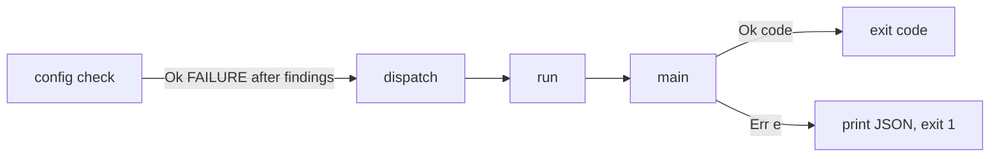
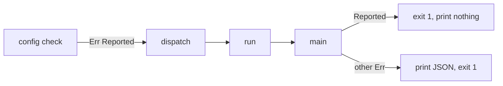
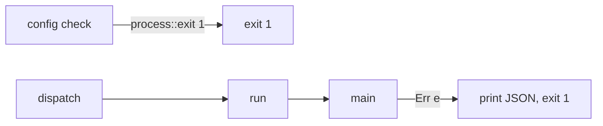
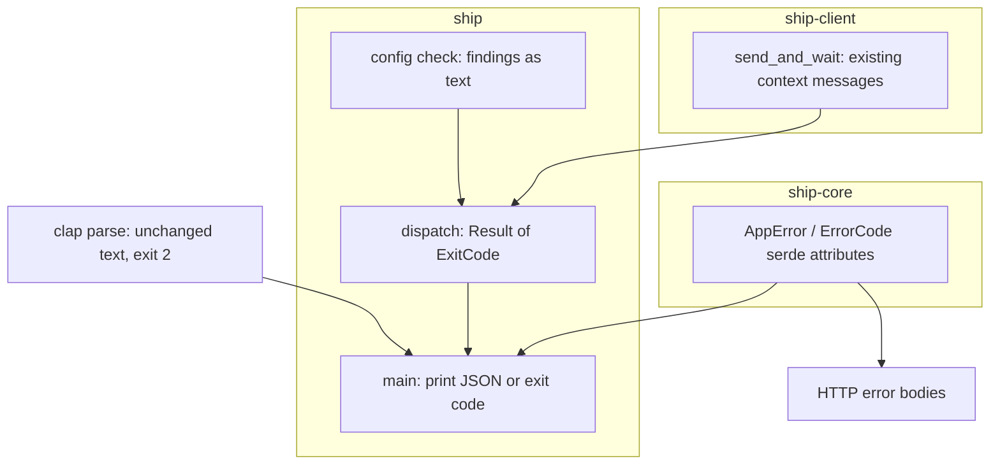

# Architecture: CLI errors as JSON

Status: Locked on 2026-10-20. Cyan chose shape A in chat ("A makes sense!") and approved the paper in Plannotator review ("LGTM!").

## Context and constraints

- `main` in `crates/ship/src/main.rs` is the only place a failed command's error reaches stderr: `run` returns `Result<()>` and `main` prints `ship: {error}` (the `Display` chain joined with `: `), then exits 1.
- clap errors never reach that point. `Cli::command().get_matches()` and `from_arg_matches(..).unwrap_or_else(|e| e.exit())` print clap's text and exit 2, or exit 0 for `--help` and `--version`. FR-006 (clap unchanged) already holds and needs no work.
- `ship config check` (`commands::check_config`) prints each finding with `eprintln!`, then returns `Err(err!(Configuration, "invalid config"))` so that `main` exits 1. Under this change, that error would become a JSON line after the findings, which FR-008 forbids.
- `AppError` lives in `ship-core` and is shared by the server and the client. The server already serializes it as the HTTP error body, and the client deserializes that body back into an `AppError`, then wraps it with its own `.context(..)`. Serializing the client's final error with serde therefore gives the shape FR-002 asks for, including causes the server produced.
- `InternalError` has no `rename_all`, so its cause key is `caused_by`. `ErrorCode` is `#[serde(tag = "kind", content = "data")]` with no rename, so kinds come out PascalCase. Both serde attributes are in `crates/ship-core/src/error.rs`.
- One-shot commands log to stderr through `tracing_subscriber`'s plain `io::stderr` writer, which writes synchronously. A log line can't land after a line `main` prints once `run` has returned, so FR-001 (JSON is the last line) holds without flushing tricks.
- `send --wait` already puts "nothing was sent", "the input was sent" and "the input may have been sent" on the outermost error through `.context(..)` in `crates/ship-client/src/automation.rs`. FR-007 needs no code.
- No spec documents the HTTP error body's shape today. FR-002 makes it a CLI contract too, so it has to be written down.
- `ship-core` must not learn about the CLI. A CLI-only concern such as "already reported" should stay in the `ship` crate.

## Candidate shapes

The JSON printing itself has one obvious home: `main` serializes the error instead of formatting it. What differs between the shapes is how `ship config check` fails with exit 1 without a JSON line after its findings.

### A: `run` returns an exit code

`dispatch` and `run` return `Result<ExitCode>`. Every arm returns `Ok(ExitCode::SUCCESS)` except `config check`, which prints its findings and returns `Ok(ExitCode::FAILURE)` when there are any. `main` prints JSON only for `Err`. Cost: the success value of a dozen dispatch arms changes from `()` to an exit code, a mechanical edit. Failure mode: a future command could return `Ok(FAILURE)` without printing anything, failing silently. The type at least makes that a visible choice.

### B: a "reported" marker error

`config check` returns an error whose code means "already printed", and `main` skips printing for it. Cost: either a new `ErrorCode` variant in `ship-core`, which leaks a CLI concern into the shared type and the HTTP schema, or a sentinel message to match on, which is fragile. Failure mode: the marker gets wrapped by `.context(..)` somewhere and `main` no longer recognizes it.

### C: `config check` exits the process itself

`check_config` calls `std::process::exit(1)` after printing. Cost: one line. Failure mode: `exit` skips destructors, so the diagnostics guard (`SHIP_TRACE` timeline) and the tokio runtime are not dropped cleanly, and a command that exits from deep inside is easy to miss when reading `main`.

The outcome that matters most is that the CLI's failure contract stays in one visible place, `main`, without CLI-only cases leaking into `ship-core`.

## Decision

Shape A. It keeps every exit decision in `main` and in the types, while B puts a CLI concern into the shared error type and C hides an exit inside a command.

## Structure

- **clap parse** owns usage errors, `--help` and `--version`, exactly as today.
- **main** owns the failure contract: on `Err`, it serializes the `AppError` to one line on stderr and exits 1, and on `Ok(code)` it exits with that code. It prints nothing to stdout.
- **dispatch** returns `Ok(SUCCESS)` for every command that works and passes `Err` up unchanged.
- **config check** prints findings as text and turns "found some" into `Ok(FAILURE)`.
- **ship-core error types** own the JSON spelling: `causedBy` and snake_case kinds, shared by the CLI line and HTTP bodies.
- **send_and_wait** is unchanged. Its context messages already satisfy FR-007.

## Key decisions

1. **Print with serde in `main`.** `serde_json::to_string(&error)` on the final `AppError`. Rejected: a CLI-specific error printer or a flatter shape (the product paper rules it out), and printing from each command (scatters the contract).
2. **If serialization fails, fall back to today's text line.** `AppError` holds only strings, codes and `serde_json::Value`, so this shouldn't happen, but the fallback keeps exit 1 and some message. Rejected: panicking, or printing nothing.
3. **`config check` fails through an exit code (shape A).** Rejected: shapes B and C, for the reasons above.
4. **Leave clap's parse path alone.** It already exits 2 with text before `run` starts. Rejected: switching to `try_get_matches` and converting clap errors to `AppError`, which the product paper ruled out.
5. **Rename at the type: `#[serde(rename_all = "camelCase")]` on `InternalError` and `rename_all = "snake_case"` on `ErrorCode`.** The server, the client and the OpenAPI schema all derive from these types, so they change together. Rejected: renaming only in the CLI printer, which would make the CLI line differ from HTTP bodies and break FR-002.
6. **Bare `ship` (the full-screen client) and foreground `ship server` follow the same rule.** If they fail before or after the UI runs, the error is printed as JSON. One rule for every `Err` that reaches `main` is simpler than exceptions. Status line errors inside the UI are untouched (a product non-goal).
7. **Document the error body in a spec.** The shape (`source`, `message`, `type.kind`, `type.data`, `data`, `causedBy`, and `code`/`error` for external errors) goes into the pane automation spec's error requirement, or a shared spec if one fits better. Program.md picks the exact spec.

## Risks and unknowns

- **Breaking HTTP clients.** Renaming `caused_by` and the kinds changes HTTP error bodies. The only known consumers are Ship's own client, which shares the types, and Cyan's scripts. Rollback is reverting two attributes.
- **A human reading JSON at the terminal.** Someone running bare `ship` without a server, or a typo'd pane ID, sees a JSON line instead of a sentence. The product paper accepted this (no terminal detection). If it grates in use, a later change could add a pretty-print, but it's out of scope here.
- **Silent `Ok(FAILURE)`.** Shape A lets a future command exit 1 without printing anything. Only `config check` does today, and it prints its findings first.
- **External errors.** `ExternalError.error` is a lossy string snapshot, such as a reqwest message. That is the same as in HTTP bodies, so it meets FR-002, but scripts get less structure for network failures than for internal ones.
