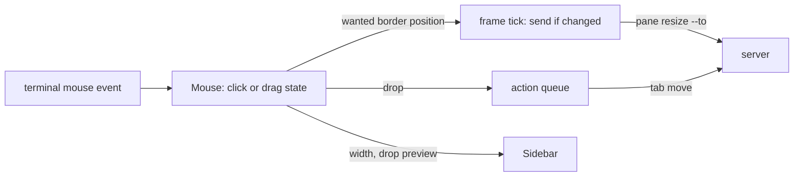
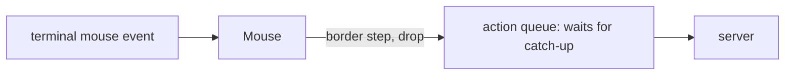
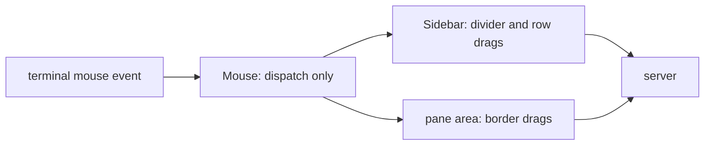
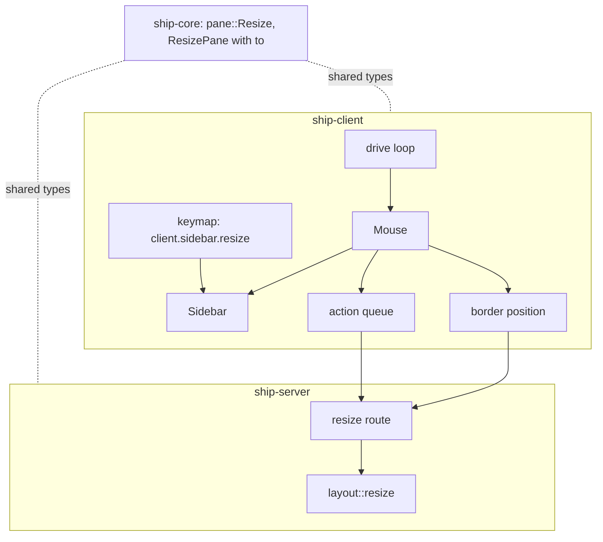

> Superseded on 2026-10-13 by `openspec/changes/archive/2026-10-14-mouse/design/product.md`, which carries this change forward with right-click menus against server-owned selection and the ordered input lane.

# Mouse drag: architecture

Status: Draft, written on 2026-10-11 against the [product paper](product.md) as locked with amendment A-1. Cyan picked absolute border positions in chat before this draft ("i think i prefer the amended version. let's go for it!") and kept `amount` beside the new `to` ("should we keep it as amount?", answered with the recommendation and no objection). Not locked.

## Summary

All three drags live in the client's mouse router, which turns a press into either today's click or one of three drags. Each drag ends somewhere that already exists: border drags call `pane resize --to`, a resize mode that already exists inside the server and is now exposed; tab drops go through the action queue keys already use as one `tab move`; and sidebar width stays inside the client. The server gains only the `to` option.

Border resizes follow FR-027 as written: one request per frame when the position changed, sent without waiting for earlier ones. On a lossy network two of them could arrive out of order and leave the border a few cells off; Cyan accepted that in chat as the 80/20 trade ("just do the thing"), with ordered delivery noted as a future improvement (Key decision 2).

## Context and constraints

- **The client's loop.** `crates/ship-client/src/ui/mod.rs` `drive` is one `tokio::select!` loop. Server commands from keys go through `queued` and `running`: one at a time, each waiting until the replica shows the previous edit (`observer.caught_up`). View PUTs have their own one-in-flight slot (`putting`), paced by a 16 ms `FRAME` tick. Tab drops reuse the key queue; border drags use neither path, only the `FRAME` tick (Key decision 2).
- **The mouse router.** `ui/mouse.rs` `Mouse::route` returns `Clicked::{Select, Fold, Frame}` and remembers only which pane a press started in, for program mouse input.
- **Geometry.** The server publishes `TabGeometry` with each pane's `frame` and `content`, relative to the tab's top-left. Adjoining frames share their border cells, so a border cell lies in two or more frames and in no content.
- **Sidebar.** `ui/sidebar.rs` draws a tui-tree-widget tree with a fixed 2-column indent, a right divider column, and a `tabs` title with a blank row above the tree. Rows have no space between them. `row_at` already maps a position to a row and its fold marker. `Sidebar.width` is overwritten from config on every reload.
- **Server resize.** `ship-server/src/state/layout.rs` `resize` already turns a relative amount into an absolute target length, binary-searches the furthest target that keeps every pane at 1x1 content or more, and stores it with `geometry::ratio_for`. Absolute positioning changes only how the target is chosen.
- **Tab move.** `ship-core` `tab::Move` takes a tab and one `Destination`: a parent, top level, or before/after a sibling.
- **Client actions** (`ClientAction`) are declared in `ship-client/src/keymap.rs`, so the new `client.sidebar.resize` stays in the client.
- **Hard limits from the product paper.** No server or `ship-core` change beyond FR-025 (SC-006). The client draws only server-published layout (FR-008). About 350 to 500 client lines plus 30 to 50 server and core lines (SC-007).

## Candidate shapes

### A. The router owns every drag; border resizes go out once per frame (winner)

`Mouse` holds one drag state: border, divider or row. Border drags write a wanted position into `drive`, and the frame tick sends it when it differs from the last one sent, without waiting for earlier requests. Tab drops become one queued `tab move`. Divider drags set the sidebar's width directly. One owner means one drag at a time by construction, and the click paths keep their current code. Cost is about as estimated. Failure mode: `mouse.rs` grows from a click router into a small state machine, and must keep click and drag paths clearly apart.

### B. Everything through the action queue

Border steps are queued like key actions. This reuses the most code, but the queue waits for the replica to catch up after each edit, which is exactly the waiting absolute positions were chosen to remove, and a long drag queues work behind key actions. Rejected.

### C. Each widget owns its own drags

`Sidebar` handles divider and row drags; a pane-area component handles borders; `Mouse` only dispatches. Each piece sits next to the drawing it affects, but drag state is split across three owners, so "one drag at a time" and "a press that never moves is a click" must be enforced in three places. Rejected.

## Decision

**A.** What matters most is that border drags track the pointer without waiting for the replica, while keeping one place that decides click versus drag; B gives up the first and C the second.

## Structure

| Box | Owns |
| --- | --- |
| `Mouse` (`ui/mouse.rs`) | The press, the one-cell threshold, and the single current drag: which border edges (a pane and a direction each), the divider, or which tab row. Turns pointer positions into a wanted border position, a sidebar width, or a drop. |
| `Sidebar` (`ui/sidebar.rs`) | The configured width and a client-local override; the drop target for a pointer position while a row is dragged, including which depths are valid; drawing the drop line. |
| Border position (in `drive`) | The wanted and last-sent border position per grabbed edge. Sent requests are spawned and their results ignored. |
| Action queue (in `drive`, existing) | The `tab move` from a drop, run like any key action. |
| Keymap (`keymap.rs`) | The `client.sidebar.resize` action and its `left`/`right` direction. |
| `ship-core` | `to` on `pane::Resize` and `ResizePane`, and the CLI's conflict with `amount`. |
| `layout::resize` (server) | Choosing the target from either `amount` or `to`, then the existing clamping and ratio. |

## Key decisions

1. **Edges are named by a pane and a direction** (FR-026), resolved by the server exactly as relative resize resolves them. Rejected: naming the split by its path in the layout tree, as Herdr does, which breaks whenever the layout changes elsewhere mid-drag, so Herdr has to cancel the drag.
2. **One border resize per frame, sent without waiting** (FR-027 as written). Each frame tick spawns `pane resize --to` if the wanted position differs from the last one sent, and ignores the result: a gone pane shows up in the replica and ends the drag (FR-026). The view PUT's one-in-flight slot was considered and rejected as more code for a rare case. Accepted risk: requests travel on separate pooled connections, so on a lossy network a stale position can land after a newer one. Mid-drag the next frame corrects it; only the last two of a drag can leave the border off, and the user drags again. Rejected for now: a streaming batch endpoint (ordered NDJSON requests through the router), which fixes ordering generically but is new public interface for a rare case. Also rejected: resize frames on the input stream, which couples the server to one client's ordering needs.
3. **A junction grabs one edge per axis**, each with its own wanted position, so a diagonal drag sends up to one resize per axis per frame. Rejected: a combined two-axis resize, which would be a second new server option.
4. **The drop line is an underline on the cells of the row above the gap**, from the target depth's indent to the sidebar's right edge. The gap above the first row uses the blank row under the `tabs` title. Rejected: inserting a temporary blank row, which shifts every row below it, so the drop target would jitter under the pointer.
5. **Valid depths at a gap run from the depth of the row below to one more than the depth of the row above** (the row below counts as depth 0 at the end of the list). The pointer's column, counted in 2-column indent steps from the tree's left edge, picks the depth and is clamped into that range. The deepest depth means "child of the row above", which becomes a move to that parent, or before its first visible child when it is expanded. Shallower depths mean "after the row above's ancestor at that depth". This is the standard outliner rule, and it keeps the tab landing where the line is drawn. It is narrower than FR-015's wording ("or any of its ancestors' levels") but within "the depths valid at that gap"; flag in review if that reading is wrong.
6. **Gaps inside the dragged tab's own subtree, and gaps that would leave it where it is, have no target** (FR-017), worked out by the client from the replica's tree. The server's own rejection is the backstop if the tree changed mid-drag (FR-019).
7. **Sidebar width keeps the configured value and an optional override separately.** A reload drops the override only when the configured value changes (FR-013). The divider drag and `client.sidebar.resize` both set the override through the same clamping (FR-012). A width change reaches the server through the existing view PUT, not a new path.
8. **`client.sidebar.resize` takes its own two-value direction (`left`, `right`)**, so `up` or `down` is rejected at config load with the usual file and key location. Rejected: reusing `ship_core::command::Direction` and failing at runtime.
9. **`to` is mutually exclusive with `amount`** on both the CLI (clap conflict, exit 2) and the HTTP body (validation error). Rejected: letting one silently win.

## Risks and unknowns

- **Underline visibility.** Some terminals or fonts draw underlines faintly. If the drop line is hard to see in practice, a reverse-video or colored cell run is the fallback; it changes only drawing.
- **Off-by-one in `to`.** Product FR-025 defines `to` as the cell where the border is drawn. The server measures the first child's length including its shared border cell, so the conversion needs checking against `ship pane get` output at the program stage.
- **Remote drags.** The border moves one round trip after the pointer, since the client draws only published layout (about 20 to 40 ms within a region, 150 to 250 ms across the world). Prediction is ruled out. If remote drags feel bad in real use, measure first.
- **Future improvement: ordered delivery.** If out-of-order resizes show up in real use, either reuse the view PUT's one-in-flight pattern for border drags (about 15 client lines) or add a streaming batch endpoint that runs NDJSON requests through the router in order. Neither is needed until a concrete case appears.
- **Drag reporting.** crossterm's `EnableMouseCapture` turns on button and any-motion reporting, which drags need. Terminals that ignore those modes won't drag; record them under SC-001.
- **Hidden rows.** The sidebar doesn't scroll, so rows past its bottom can't be targets. Out of scope per the non-goals.
- **Mouse router growth.** If `mouse.rs` mixes click and drag paths badly, splitting drag hit-testing into a sibling module is a program-stage choice, not a shape change.
