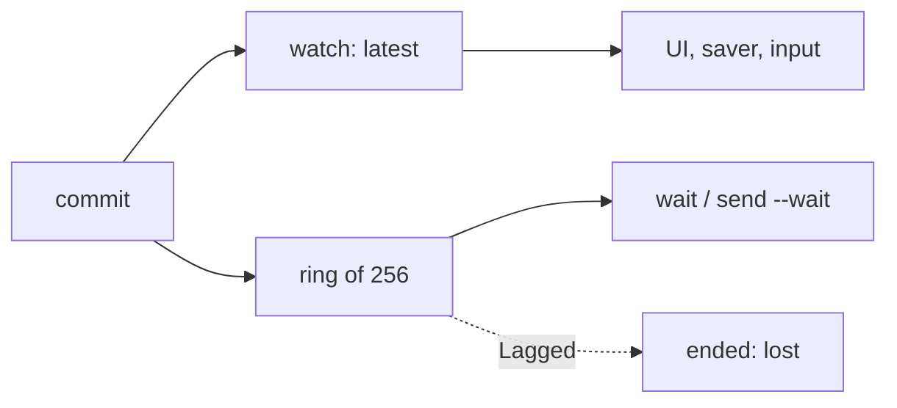
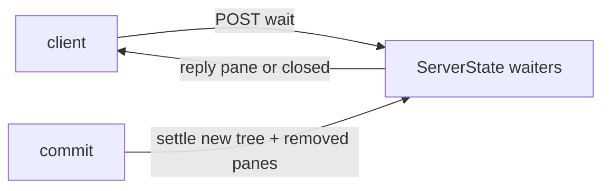
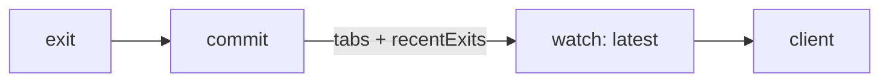
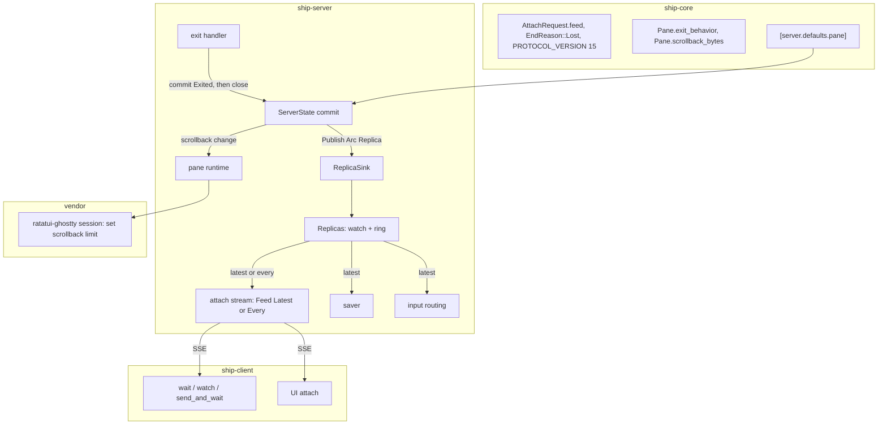

# Architecture: pane defaults and exit behavior

Status: Locked on 2026-10-21, approved in Plannotator review ("LGTM"). Cyan chose shape A in chat on 2026-10-21 ("perfect! i agree with your defaults!"). That covers both channels kept together in a wrapper struct, a per-attachment feed mode, a ring of 256, and FR-003 amended for a waiter that falls behind. The product paper amendment is recorded in `product.md`.

Summary: most of this change is settled plumbing. Panes gain `exit_behavior` and `scrollback_bytes`, new panes read them from `[server.defaults.pane]`, saved tabs keep them, and the protocol moves to 15. The one real design question was FR-003. A `ship pane wait` has to see a program's exit and its status even when the pane closes right after. Today it can't, because replicas reach clients through a channel that keeps only the newest value. The chosen shape keeps that channel for everything that wants the latest state, and adds a bounded ring next to it that a client can opt into per attachment. The server commits the exit and the close as two revisions, and a waiter on the ring sees both. The cost is one amendment to FR-003: a waiter that falls more than 256 revisions behind fails with "fell behind" instead of seeing the exit.

## Context and constraints

- `commit()` (`crates/ship-server/src/state.rs:150`) applies an edit to cloned `Arc` trees, repairs each attachment's selection, bumps `revision`, builds a replica (`replica()`, `state.rs:367`, which copies viewed tabs and computes geometry) and publishes one `Arc<Replica>` through the relay bus. Every message to the state actor is its own commit. Nothing batches commits today.
- The relay bus delivers replicas to one `watch::Sender` (`crates/ship-server/src/lib.rs:198`, subscribed at `:203`). Its receivers are the startup baseline (`lib.rs:200`), the saver (`saver.rs:106`), input routing (`input.rs:61`) and every attach stream (`attach.rs:124`). All of them want the latest value and rely on `borrow()`.
- `Progress::next` (`attach.rs:141`) skips any replica not newer than the one it last sent. A slow client therefore only pays to serialize the newest replica. The JSON serialization at `attach.rs:111` is the only per-client cost.
- Attaching is itself a commit. `Message<Attach>` (`state.rs:789`) inserts the viewing record and returns that commit's replica as the `Attached` seed.
- The client's `wait()`, `watch()` and `send_and_wait()` (`crates/ship-client/src/automation.rs:90` onward) attach as an observer and walk replicas. A pane missing from a replica fails the wait with `pane P closed`. The UI's key-binding waits and `execute.rs:254`, `:264` go through the same functions.
- The exit handler (`state.rs:971`) sets `PaneStatus::Exited(status)` in one commit. A pane is closed by `layout::close` (`state.rs:694` for `ship pane close`).
- The relay `Sink` for `watch::Sender` (`crates/ship-core/src/relay.rs:119`) reports `Closed` once every receiver is gone, and the bus then drops the sink. `broadcast::Sender::send` errors whenever no receiver exists, which is the normal state for a ring nobody reads.
- AGENTS.md: shared state is server-authoritative, and clients render what the server publishes. The client and server talk only through explicit commands, responses and events. Ship should feel at least as snappy as tmux, Zellij and Herdr.
- Reference multiplexers, checked from source. Herdr publishes `pane.exited` into a numbered 512-event ring and answers overflow with `Lost`. Zellij answers only the creator's `run --block-until-exit` from the exit handler. Neither gives an arbitrary waiter the status of a pane that closed itself.

## Candidate shapes

### A: latest feed plus a full-history ring, chosen per attachment

`commit()` publishes the same `Arc<Replica>` to the existing `watch` and to a `broadcast` ring of 256. An attach request names its feed. `latest` reads the `watch` as today. `every` reads the ring, sends each revision newer than its seed, and ends with `lost` if it falls more than 256 behind. The exit handler commits `Exited(status)`, then commits the close when the exit behavior says to close. Waiters keep evaluating any condition they like on the client. Cost: a wrapper type, a mode field, an `EndReason`, and per-revision serialization for `every` streams only. Failure mode: a waiter that lags past the ring fails with "fell behind" rather than reporting the exit, which is why FR-003 is amended.

### D: server-side waits

`POST /panes/{id}/wait {status, after}` registers a condition and a reply channel in `ServerState`. After each edit, `commit()` settles every waiter against the new tree, or against the final value of a pane this commit removed. The exit handler sets `Exited` and closes in the same commit. Cost: a new route, `Condition` moving to ship-core, and a removed-pane collection in `commit()`. Failure mode: none for FR-003, which holds strictly. But the server prescribes which conditions exist, and every new kind of wait is a server change.

### B: recent exits in the replica

The exit handler removes the pane and appends `{pane, status}` to a capped `recentExits` list in `Replica`, in the same commit. Waiters check the list when their pane vanishes. Cost: small. Failure mode: the replica, which describes current state, starts carrying a history log that every client receives and that has to be capped and aged.

The outcome that matters most is letting clients wait on any combination of state without the server prescribing conditions, while the UI keeps latest-only publication.

## Decision

Shape A. It keeps waits general on the client and leaves the UI's coalesced feed alone. D guarantees FR-003 strictly but makes the server own every wait condition, and B puts history into the state snapshot.

## Structure

- **exit handler** owns FR-002. It commits `Exited(status)` with the program records cleared. Then, still inside the same message, it commits the close as `ship pane close` would when the exit behavior is `close`, or `keep_failed` with code 0. Nothing can interleave, because the actor handles one message at a time.
- **ServerState commit** is unchanged. It publishes one `Arc<Replica>` per revision.
- **ReplicaSink** is the relay subscriber that replaces the bare `watch::Sender`. It sends to the ring and ignores the ring's no-receiver error, then sends to the `watch`, whose result alone decides whether the sink is closed.
- **Replicas** is the handle in `AppState`, replacing `replicas: watch::Receiver`. `latest()` hands out a `watch` receiver. `every()` subscribes to the ring.
- **attach stream** builds its `Feed` before asking the state actor to attach, so the attach commit and everything after it are in the ring. `Latest` behaves as today. `Every` sends each ring replica newer than the seed. On `Lagged` it ends with `EndReason::Lost`, and on a closed ring with `ServerShutdown`.
- **saver, input routing, UI attach** keep using `latest()` unchanged.
- **wait / watch / send_and_wait** attach with `feed: every` and keep their loops. `next()` reports `Ended(Lost)` as "fell behind the server while waiting on pane P".
- **ship-core model and defaults** own the two new pane fields and the `[server.defaults.pane]` table.
- **pane runtime and session** apply a changed `scrollback_bytes` to the live terminal through one new session-thread message.

## Key decisions

1. **Keep `watch` and add a ring beside it (shape A).** Rejected: broadcast alone, which would make the saver, input routing and UI rebuild "current value" and coalescing by hand. Also rejected: shapes D and B, for the reasons above. Also rejected: the Zellij-style `create --wait`, which isn't composable and would have narrowed FR-003.
2. **The feed is chosen per attachment, defaulting to `latest`.** `AttachRequest` gains `feed: "latest" | "every"`, serde default `latest`. The UI doesn't set it. Rejected: a separate event route, which would duplicate attach, detach and the observer record.
3. **Ring capacity 256, fixed in code.** Each slot is an `Arc<Replica>`, and old replicas share untouched tabs, so the memory cost is small. Rejected: a config setting, because nothing yet suggests anyone needs to tune it. Revisit only if `lost` shows up in practice.
4. **Overflow ends the stream with `EndReason::Lost`.** Rejected: silently skipping to the latest replica, which could misreport an exit as `pane P closed`. Also rejected: an unbounded per-client queue, which lets a stuck client grow server memory without limit.
5. **Exit and close are two commits, and the order is part of the protocol.** The pane-automation spec will say: when a pane's program exits, an `every` feed carries a revision with the pane `Exited(status)` before the revision that removes it. This one ordering is the only commit-granularity promise. Future batching of other commits, such as status reports, stays free. Rejected: a general promise that every commit is published.
6. **The wrapper struct owns both channels.** `Replicas` and `ReplicaSink` live in ship-server. Callers never touch the `broadcast::Sender` directly, so the no-receiver rule lives in one place. Rejected: two separate bus subscriptions, where the ring's no-receiver error would read as `Closed` and the bus would drop the sink.
7. **`Pane` gains `exit_behavior` and `scrollback_bytes`, filled from `[server.defaults.pane]` at creation.** Server settings move from `[server] shell` and `[server] scrollback_bytes` to `defaults.pane.*` in `crates/ship-core/src/defaults.toml`, read when a pane is spawned (`pane.rs:274` today). No alias, per the product paper.
8. **Scrollback changes on a live pane go through one new session-thread message in `vendor/ratatui-ghostty/src/session.rs`.** It calls libghostty's `Terminal::set_scrollback_max_bytes(Option<usize>)`, which prunes immediately when the limit is lowered. Today the limit is set only when the terminal is built (`session.rs:1061`). Rejected: rebuilding the terminal, which would lose the screen.
9. **Saved panes missing the new fields get the current defaults on restore.** Serde defaults fill them in. Rejected: a format version bump for saved files.
10. **`PROTOCOL_VERSION` goes from 14 to 15** (`crates/ship-core/src/protocol.rs:23`). This covers the new pane fields, `AttachRequest.feed` and `EndReason::Lost`.
11. **Specs touched (SC-005).** pane-programs: "Exited programs". pane-history: the scrollback limit. config-file: the shell and scrollback settings. session-structure: set attributes. session-restore: "Restore on startup". pane-automation: wait `exited`, the `every` feed, `lost` and the exit ordering from decision 5.

## Risks and unknowns

- **A waiter can still miss an exit.** If an `every` stream falls 256 revisions behind, the wait fails with "fell behind" and never reports the status. FR-003 is amended to allow this. At Ship's commit rates it would take a stalled client, but nothing makes it impossible.
- **Every revision is serialized for each `every` stream.** A waiter attached through an output burst pays one JSON serialization per commit. This hasn't been profiled. It's bounded by how long waits stay attached and how many run at once. If it ever feels slow, measure replica serialization on a busy session first.
- **The exited pane is visible for one revision.** UI clients may draw `exited (N)` for a frame before the close lands. The `watch` usually merges the two commits, and showing it briefly is how exited panes look today anyway.
- **Commit batching later.** Anyone who merges commits in the future has to keep decision 5's ordering. The spec sentence is the guard.
- **Each wait still makes two shared commits.** The observer's attach and detach change `viewers`, as they do today. This change doesn't make that worse, and it isn't addressed here.
